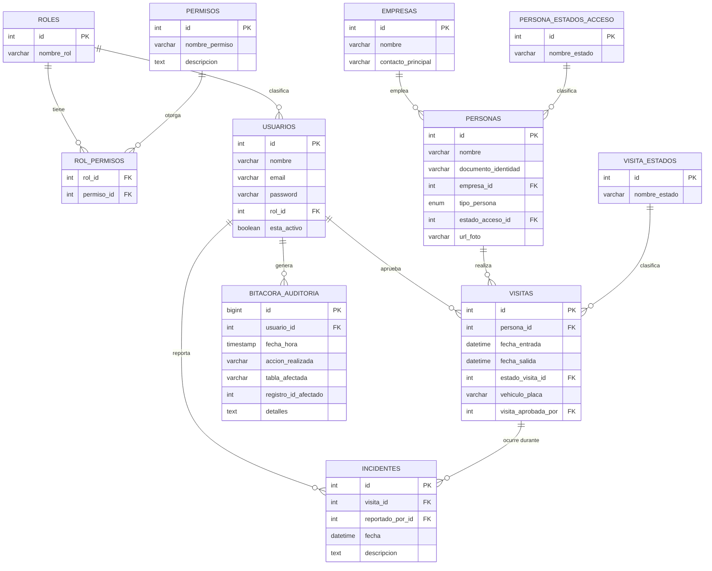

# SICA — Sistema Integrado de Control de Acceso para Zona Acme

## 1. Descripción del proyecto

El Complejo Empresarial "Zona Acme" controlaba el acceso de sus más de 30 empresas con libros de
registro en papel y radios: sin trazabilidad, sin forma de saber quién está adentro en caso de
emergencia, y con filas largas por invitados no anunciados. **SICA** reemplaza ese proceso manual
por una aplicación de escritorio en Java que:

- Registra entradas y salidas de trabajadores e invitados.
- Maneja los casos reales de portería: un invitado ya pre-registrado, uno que llega sin avisar,
  un trabajador que olvidó su carnet, y una persona que salió sin registrar su salida.
- Aplica permisos por rol (RBAC): cada acción crítica exige un permiso concreto, verificado
  contra la base de datos antes de ejecutarse — no hay reglas de negocio "cableadas" en el código.
- Deja constancia de cada acción crítica (logins, check-in/check-out, aprobaciones, bloqueos,
  incidentes) en una bitácora de auditoría inmutable.
- Permite restringir el acceso de una persona de inmediato y reportar incidentes de seguridad.

## 2. Modelo de la base de datos

Scripts en [`sica_proyecto/src/main/resources/db/`](sica_proyecto/src/main/resources/db/):
[`schema.sql`](sica_proyecto/src/main/resources/db/schema.sql) (creación de las 11 tablas) y
[`data.sql`](sica_proyecto/src/main/resources/db/data.sql) (datos de prueba, incluyendo un
usuario por cada rol).



`roles`/`permisos`/`rol_permisos` son las tablas de RBAC: los permisos no están escritos en el
código Java, sino en la base de datos — un rol nuevo, o un permiso nuevo, se crea con SQL, sin
tocar ni recompilar el programa. `persona_estados_acceso` y `visita_estados` son catálogos
(lookup tables) que evitan strings mágicas sueltas por el código.

## 3. Arquitectura y decisiones de diseño

### 3.1 Por qué hexagonal (puertos y adaptadores)

El requisito central del proyecto es RBAC + auditoría: **toda** acción crítica debe pasar por una
verificación de permisos y dejar rastro en la bitácora, sin importar si viene del Guarda, del
Funcionario o de un futuro cliente web. Eso solo es sostenible si esa lógica vive en **un solo
lugar** que no dependa de Swing ni de MySQL — porque si la regla "verifica el permiso antes de
actuar" estuviera repetida dentro de cada pantalla, sería cuestión de tiempo antes de que alguien
agregue una pantalla nueva y se le olvide poner el chequeo (de hecho, así estaba el proyecto
quando lo heredamos: `ValidadorAcceso.validarPermiso(...)` existía, pero nadie lo llamaba).

La arquitectura hexagonal fuerza esa regla con la estructura de paquetes, no con disciplina:

```
com.sica
├── dominio/            modelos y excepciones de negocio, sin dependencias de nada más
├── aplicacion/
│   ├── puerto/entrada/  casos de uso que la UI puede invocar (interfaces)
│   ├── puerto/salida/   lo que el core necesita de persistencia (interfaces)
│   └── servicio/        el "core": implementa puerto/entrada, y AQUÍ es donde se llama
│                        validarPermiso(...) y registrarEvento(...) — una sola vez por caso de uso,
│                        no una vez por pantalla
└── infraestructura/
    ├── adaptador/entrada/  Swing (guarda, funcionario, supervisor) y controladores
    ├── adaptador/salida/   los DAO de MySQL, que implementan puerto/salida
    └── config/             el "composition root": arma qué implementación concreta usa cada interfaz
```

La regla de dependencia es siempre hacia adentro: `infraestructura` conoce a `aplicacion`, pero
`aplicacion` nunca importa nada de `infraestructura`. Eso es lo que permite que, por ejemplo,
`ControladorEntradasImpl` (el caso de uso de entrada/salida) sea el único lugar que decide "revisa
el permiso, revisa si hay una visita pendiente, revisa la salida olvidada, audita" — y que tanto
`PantallaGuarda` (Swing) como cualquier otra interfaz futura (una API REST, una consola) reciban
esa misma garantía gratis, sin reescribir nada.

*Nota honesta:* los constructores por defecto de los servicios (`ControladorEntradasImpl()`, etc.)
todavía instancian el adaptador MySQL directamente por conveniencia, en vez de recibirlo inyectado
desde `FabricaServicios`. Cada servicio expone un constructor secundario que sí acepta las
interfaces (pensado para pruebas), pero nada en el proyecto lo usa todavía. Es una limitación
conocida del "composition root", no un descuido — se documenta aquí en vez de esconderla.

### 3.2 Principios SOLID aplicados

- **SRP** — cada clase tiene una sola razón para cambiar: `ConsultaVisitaMySQL` solo persiste
  visitas, `ControladorEntradasImpl` solo orquesta el caso de uso de entrada/salida,
  `RegistradorAuditoriaImpl` solo escribe en la bitácora.
- **OCP** — se puede agregar una nueva forma de persistir (por ejemplo, otro motor de base de
  datos) escribiendo un nuevo adaptador que implemente el mismo puerto (`ConsultaVisita`, etc.),
  sin tocar ni una línea del core.
- **LSP** — cualquier implementación de un puerto (`ValidadorAcceso`, `ConsultaPersona`...) puede
  sustituir a otra sin que el código que la usa se entere ni se rompa.
- **ISP** — los puertos son pequeños y específicos (`ConsultaBitacora` tiene un solo método) en
  vez de una interfaz gigante tipo "repositorio genérico" con todo mezclado.
- **DIP** — el core depende de abstracciones (`aplicacion.puerto.*`), no de clases concretas de
  MySQL (ver la nota honesta de arriba sobre el composition root).

### 3.3 Patrones de diseño usados (5)

1. **Repository** — `aplicacion.puerto.salida.*` (p. ej. `ConsultaVisita`) más su implementación
   en `infraestructura.adaptador.salida.mysql.*`: aísla el resto del sistema del SQL concreto.
2. **Adapter** (Ports & Adapters) — toda `infraestructura.adaptador.*`: las pantallas Swing
   adaptan eventos de UI a los puertos de entrada; los DAO de MySQL adaptan JDBC a los puertos
   de salida.
3. **Factory Method** — `infraestructura.config.FabricaServicios`: centraliza la creación de los
   servicios (`crearValidadorAcceso()`, `crearGestorIncidentes()`, `crearGestorMantenimiento()`...)
   devolviendo siempre el tipo de la interfaz, nunca el de la clase concreta.
4. **Singleton** — `ConexionBD` (una sola conexión JDBC) y `SesionUsuario` (una sola sesión de
   usuario activa a la vez), ambas con constructor privado y `getInstancia()`.
5. **Strategy / Dependency Inversion por interfaces** — `ValidadorAcceso`, `ControladorEntradas`,
   `GestorAprobaciones`, `GestorIncidentes`, `GestorMantenimiento`, `RegistradorAuditoria`: el
   comportamiento concreto es intercambiable porque todo el sistema programa contra la interfaz,
   nunca contra la implementación.

### 3.4 Lambdas y Stream API

`Rol.tienePermiso(...)` resuelve la pregunta central del RBAC ("¿este rol tiene este permiso?")
con la Stream API en vez de un bucle manual:

```java
public boolean tienePermiso(String nombrePermiso) {
    if (permisos == null) return false;
    return permisos.stream().anyMatch(p -> p.getNombrePermiso().equalsIgnoreCase(nombrePermiso));
}
```

### 3.5 Por qué el "actor" se pasa como parámetro, no como variable global

Los casos de uso (`ControladorEntradas.procesarIngreso(Usuario actor, ...)`, etc.) reciben
explícitamente **quién** está haciendo la acción, en vez de leerlo ellos mismos de
`SesionUsuario.getInstancia()`. Es la capa de UI (`GestorIngresos`, las pantallas) la que lee la
sesión y se la pasa al core. La razón: `SesionUsuario` es un detalle de la interfaz de escritorio
(un singleton en memoria de un solo usuario a la vez); si el core dependiera de él directamente,
sería imposible reutilizar esos casos de uso desde, por ejemplo, una API donde cada request trae
su propio usuario autenticado. Pasar el actor como parámetro mantiene el core ignorante de cómo
se identificó al usuario.

## 4. Roles y funciones (con las credenciales de prueba)

Contraseña de los 4 usuarios de prueba: `1234` (sembrados en `data.sql`).

### 4.1 Guarda de Seguridad — `guarda@sica.com`

Permiso asignado: `registrar_visita`. Pantalla:
[`PantallaGuarda.java`](sica_proyecto/src/main/java/com/sica/infraestructura/adaptador/entrada/swing/PantallaGuarda.java).

| Opción del menú | Qué hace |
|---|---|
| **Registrar Entrada** | Ingreso normal por documento. Si la persona tiene una visita ya "Aprobada" de hoy (por pre-registro o por aprobación posterior del Funcionario), hace el check-in directo. Si detecta una visita anterior sin cerrar, la cierra automáticamente antes de continuar (flujo de "salida olvidada"). Si la persona está bloqueada, rechaza el ingreso. |
| **Entrada Especial (sin carnet / invitado no anunciado)** | Crea la visita en estado "Pendiente de Aprobacion" en vez de dejar entrar a la persona. Cubre tanto al invitado no anunciado como al trabajador que olvidó su carnet — la diferencia entre esos dos casos queda en el texto de la bitácora, no en un estado distinto (ver sección 6). |
| **Registrar Salida** | Cierra la visita activa ("Dentro") de la persona. |

### 4.2 Funcionario de Empresa — `laura@techcorp.com`

Permisos asignados: `aprobar_visita`, `generar_reporte`. Pantalla:
[`PantallaFuncionario.java`](sica_proyecto/src/main/java/com/sica/infraestructura/adaptador/entrada/swing/PantallaFuncionario.java).

| Opción del menú | Qué hace |
|---|---|
| **Pre-registrar Visita** | Flujo del "invitado pre-registrado": autoriza a una persona que ya existe en el sistema ANTES de que llegue, dejando su visita en estado "Aprobado". Cuando llegue, el Guarda le hace check-in directo con "Registrar Entrada". |
| **Aprobar Visita Excepcional** | Lista las visitas "Pendiente de Aprobacion" (las que crea el Guarda con "Entrada Especial") y permite aprobar o rechazar cada una por su ID. |
| **Ver Reportes** | Tabla de todas las visitas (entrada, salida, estado). |
| **Limpiar Datos de Prueba** | Aparece en el menú, pero al presionarlo el Funcionario recibe "Acceso denegado" — ese permiso (`resetear_datos_prueba`) es exclusivo del Superusuario (ver 4.4). |

### 4.3 Supervisor de Seguridad — `supervisor@sica.com`

Permisos asignados: `registrar_visita`, `generar_reporte`, `bloquear_persona`,
`reportar_incidente`. Pantalla:
[`PantallaSupervisor.java`](sica_proyecto/src/main/java/com/sica/infraestructura/adaptador/entrada/swing/PantallaSupervisor.java).

| Opción del menú | Qué hace |
|---|---|
| **Reportar Incidente** | Registra un incidente de seguridad sobre una persona (por documento) con una descripción. Si esa persona tiene una visita activa ("Dentro") en ese momento, el incidente queda ligado a esa visita; si no, queda como un incidente general. |
| **Bloquear Persona** | Marca a la persona con estado de acceso "Con Prohibicion de Ingreso". Desde ese momento, cualquier intento de entrada de esa persona es rechazado (lo verifica `ControladorEntradasImpl` en cada ingreso). |
| **Desbloquear Persona** | Revierte el bloqueo, vuelve el estado a "Activo". |
| **Ver Reportes** | Misma tabla que ve el Funcionario. |

### 4.4 Superusuario — `admin@sica.com`

Tiene los 7 permisos del sistema, pero **comparte pantalla con el Funcionario**
(`PantallaFuncionario`) — es una decisión de diseño explícita, no un descuido: el enunciado no
pide una interfaz exclusiva de administración, y el Superusuario es, en la práctica, "un
Funcionario con más permisos". Por eso, en el menú que ve:

| Opción del menú | Qué hace |
|---|---|
| Pre-registrar Visita / Aprobar Visita Excepcional / Ver Reportes | Igual que en 4.2 — el Superusuario tiene esos permisos, así que le funcionan igual a como le funcionan a Laura. |
| **Limpiar Datos de Prueba** | Único botón que realmente distingue al Superusuario del Funcionario en la interfaz actual: borra visitas, incidentes y la bitácora, y desbloquea a todas las personas — pensado para dejar el sistema limpio antes de una demo, sin tener que volver a correr `schema.sql`/`data.sql` a mano. |

**Nota honesta:** el Superusuario también tiene en la base de datos los permisos
`registrar_visita`, `bloquear_persona`, `reportar_incidente` y `crear_usuario`, pero
`PantallaFuncionario` no ofrece ningún botón para ejercerlos — no existe una pantalla de "crear
usuario" en todo el proyecto. Si se necesita eso a futuro, lo natural sería darle al Superusuario
su propia pantalla (`PantallaAdmin`), del mismo tamaño que se hizo con `PantallaSupervisor`.

## 5. Instalación y ejecución

**Requisitos:** JDK 21+, Maven 3.9+, MySQL 8.

1. Crear el esquema y los datos de prueba:
   ```bash
   mysql -u root -p < sica_proyecto/src/main/resources/db/schema.sql
   mysql -u root -p < sica_proyecto/src/main/resources/db/data.sql
   ```
2. Editar las credenciales de conexión en
   [`ConexionBD.java`](sica_proyecto/src/main/java/com/sica/infraestructura/adaptador/salida/mysql/ConexionBD.java)
   para que apunten a tu propio usuario/contraseña de MySQL local.
   > ⚠️ Ese archivo trae hoy una contraseña real hardcodeada en el código fuente. Cámbiala por la
   > tuya y evita subir contraseñas reales a un repositorio, aunque sea privado.
3. Compilar y ejecutar:
   ```bash
   cd sica_proyecto
   mvn compile
   mvn exec:java -Dexec.mainClass=com.sica.Main
   ```
   (o generar el `.jar` con `mvn package` y correrlo con `java -jar target/sica.jar`).
4. Antes de una demo o de repetir pruebas: loguéate como Superusuario y usa **"Limpiar Datos de
   Prueba"** para dejar visitas, incidentes y bitácora en cero sin tener que volver a correr los
   scripts SQL a mano.

## 6. Guía de uso — flujos completos

**Invitado pre-registrado:** el Funcionario usa "Pre-registrar Visita" con el documento de la
persona. Cuando llega, el Guarda usa "Registrar Entrada": el sistema encuentra la visita ya
aprobada y hace el check-in directo.

**Invitado no anunciado / carnet olvidado:** el Guarda usa "Entrada Especial", que deja la visita
en estado "Pendiente de Aprobacion". El Funcionario (o el Superusuario) la ve y la resuelve desde
"Aprobar Visita Excepcional". El Guarda vuelve a intentar "Registrar Entrada" con el mismo
documento: si ya fue aprobada, entra; si fue rechazada, el sistema se lo informa. No hay
actualización en tiempo real de la pantalla del Guarda — es una app de escritorio de un solo hilo,
sin servidor central, así que el reintento manual reemplaza la "notificación en vivo" del
enunciado.

**Salida olvidada:** es automático — en cualquier intento de entrada, si la persona tenía una
visita anterior sin cerrar, el sistema la marca como "Cerrada por Sistema (Salida Olvidada)" y
sigue con el ingreso actual, sin bloquear a nadie.

**Bloqueo de acceso:** el Supervisor usa "Bloquear Persona" con el documento; desde ese momento,
cualquier intento de entrada de esa persona es rechazado hasta que se use "Desbloquear Persona".

## 7. Alcance y limitaciones conocidas

- No hay pantallas para crear Usuarios, Personas o Empresas nuevas: el pre-registro, la entrada
  especial y el bloqueo solo operan sobre personas que ya existen en la tabla `personas`. El
  permiso `crear_usuario` existe en la base de datos pero ninguna pantalla lo usa (ver 4.4).
- El Superusuario comparte pantalla con el Funcionario a propósito (ver 4.4) — no tiene una
  interfaz exclusiva de administración.
- El Funcionario ve todas las visitas pendientes de todas las empresas — la tabla `usuarios` no
  guarda a qué empresa pertenece cada funcionario, así que no hay forma de filtrar por empresa
  sin cambiar el esquema.
- La actualización de la pantalla del Guarda ante una aprobación no es en tiempo real (ver
  sección 6).

  //////////////////////////////////////////////////////////////////////////////////////////////////////////////////

  cd Escritorio/ 
  cd SICA 
  Ejecucion de codigo: docker compose up -d
  code . 
  USE campus;
  SELECT * FROM tabla; 
  
