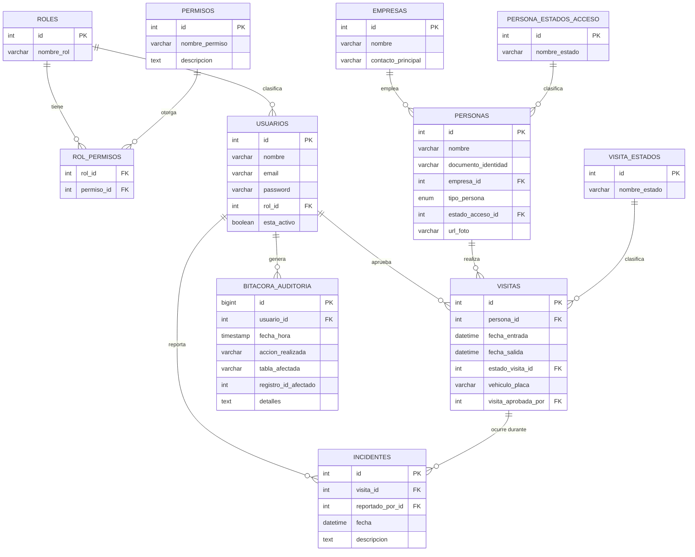

# SICA — Sistema Integrado de Control de Acceso para Zona Acme

## 1. Descripción del proyecto

El Complejo Empresarial "Zona Acme" controlaba el acceso de sus más de 30 empresas con libros de
registro en papel y radios: sin trazabilidad, sin forma de saber quién está adentro en caso de
emergencia, y con filas largas por invitados no anunciados. **SICA** reemplaza ese proceso manual
por una aplicación de escritorio en Java que:

- Registra entradas y salidas de trabajadores e invitados.
- Maneja los casos reales de portería: un invitado ya pre-registrado, uno que llega sin avisar,
  un trabajador que olvidó su carnet, y una persona que salió sin registrar su salida.
- Aplica permisos por rol (RBAC): cada acción crítica exige un permiso concreto, verificado
  contra la base de datos antes de ejecutarse — no hay reglas de negocio "cableadas" en el código.
- Deja constancia de cada acción crítica (logins, check-in/check-out, aprobaciones, bloqueos,
  incidentes) en una bitácora de auditoría inmutable.
- Permite restringir el acceso de una persona de inmediato y reportar incidentes de seguridad.

## 2. Modelo de la base de datos

Scripts en [`sica_proyecto/src/main/resources/db/`](sica_proyecto/src/main/resources/db/):
[`schema.sql`](sica_proyecto/src/main/resources/db/schema.sql) (creación de las 11 tablas) y
[`data.sql`](sica_proyecto/src/main/resources/db/data.sql) (datos de prueba, incluyendo un
usuario por cada rol).



`roles`/`permisos`/`rol_permisos` son las tablas de RBAC: los permisos no están escritos en el
código Java, sino en la base de datos — un rol nuevo, o un permiso nuevo, se crea con SQL, sin
tocar ni recompilar el programa. `persona_estados_acceso` y `visita_estados` son catálogos
(lookup tables) que evitan strings mágicas sueltas por el código.

## 3. Arquitectura y decisiones de diseño

### 3.1 Por qué hexagonal (puertos y adaptadores)

El requisito central del proyecto es RBAC + auditoría: **toda** acción crítica debe pasar por una
verificación de permisos y dejar rastro en la bitácora, sin importar si viene del Guarda, del
Funcionario o de un futuro cliente web. Eso solo es sostenible si esa lógica vive en **un solo
lugar** que no dependa de Swing ni de MySQL — porque si la regla "verifica el permiso antes de
actuar" estuviera repetida dentro de cada pantalla, sería cuestión de tiempo antes de que alguien
agregue una pantalla nueva y se le olvide poner el chequeo (de hecho, así estaba el proyecto
quando lo heredamos: `ValidadorAcceso.validarPermiso(...)` existía, pero nadie lo llamaba).

La arquitectura hexagonal fuerza esa regla con la estructura de paquetes, no con disciplina:

```
com.sica
├── dominio/            modelos y excepciones de negocio, sin dependencias de nada más
├── aplicacion/
│   ├── puerto/entrada/  casos de uso que la UI puede invocar (interfaces)
│   ├── puerto/salida/   lo que el core necesita de persistencia (interfaces)
│   └── servicio/        el "core": implementa puerto/entrada, y AQUÍ es donde se llama
│                        validarPermiso(...) y registrarEvento(...) — una sola vez por caso de uso,
│                        no una vez por pantalla
└── infraestructura/
    ├── adaptador/entrada/  Swing (guarda, funcionario, supervisor) y controladores
    ├── adaptador/salida/   los DAO de MySQL, que implementan puerto/salida
    └── config/             el "composition root": arma qué implementación concreta usa cada interfaz
```

La regla de dependencia es siempre hacia adentro: `infraestructura` conoce a `aplicacion`, pero
`aplicacion` nunca importa nada de `infraestructura`. Eso es lo que permite que, por ejemplo,
`ControladorEntradasImpl` (el caso de uso de entrada/salida) sea el único lugar que decide "revisa
el permiso, revisa si hay una visita pendiente, revisa la salida olvidada, audita" — y que tanto
`PantallaGuarda` (Swing) como cualquier otra interfaz futura (una API REST, una consola) reciban
esa misma garantía gratis, sin reescribir nada.

*Nota honesta:* los constructores por defecto de los servicios (`ControladorEntradasImpl()`, etc.)
todavía instancian el adaptador MySQL directamente por conveniencia, en vez de recibirlo inyectado
desde `FabricaServicios`. Cada servicio expone un constructor secundario que sí acepta las
interfaces (pensado para pruebas), pero nada en el proyecto lo usa todavía. Es una limitación
conocida del "composition root", no un descuido — se documenta aquí en vez de esconderla.

### 3.2 Principios SOLID aplicados

- **SRP** — cada clase tiene una sola razón para cambiar: `ConsultaVisitaMySQL` solo persiste
  visitas, `ControladorEntradasImpl` solo orquesta el caso de uso de entrada/salida,
  `RegistradorAuditoriaImpl` solo escribe en la bitácora.
- **OCP** — se puede agregar una nueva forma de persistir (por ejemplo, otro motor de base de
  datos) escribiendo un nuevo adaptador que implemente el mismo puerto (`ConsultaVisita`, etc.),
  sin tocar ni una línea del core.
- **LSP** — cualquier implementación de un puerto (`ValidadorAcceso`, `ConsultaPersona`...) puede
  sustituir a otra sin que el código que la usa se entere ni se rompa.
- **ISP** — los puertos son pequeños y específicos (`ConsultaBitacora` tiene un solo método) en
  vez de una interfaz gigante tipo "repositorio genérico" con todo mezclado.
- **DIP** — el core depende de abstracciones (`aplicacion.puerto.*`), no de clases concretas de
  MySQL (ver la nota honesta de arriba sobre el composition root).

### 3.3 Patrones de diseño usados (5)

1. **Repository** — `aplicacion.puerto.salida.*` (p. ej. `ConsultaVisita`) más su implementación
   en `infraestructura.adaptador.salida.mysql.*`: aísla el resto del sistema del SQL concreto.
2. **Adapter** (Ports & Adapters) — toda `infraestructura.adaptador.*`: las pantallas Swing
   adaptan eventos de UI a los puertos de entrada; los DAO de MySQL adaptan JDBC a los puertos
   de salida.
3. **Factory Method** — `infraestructura.config.FabricaServicios`: centraliza la creación de los
   servicios (`crearValidadorAcceso()`, `crearGestorIncidentes()`, `crearGestorMantenimiento()`...)
   devolviendo siempre el tipo de la interfaz, nunca el de la clase concreta.
4. **Singleton** — `ConexionBD` (una sola conexión JDBC) y `SesionUsuario` (una sola sesión de
   usuario activa a la vez), ambas con constructor privado y `getInstancia()`.
5. **Strategy / Dependency Inversion por interfaces** — `ValidadorAcceso`, `ControladorEntradas`,
   `GestorAprobaciones`, `GestorIncidentes`, `GestorMantenimiento`, `RegistradorAuditoria`: el
   comportamiento concreto es intercambiable porque todo el sistema programa contra la interfaz,
   nunca contra la implementación.

### 3.4 Lambdas y Stream API

`Rol.tienePermiso(...)` resuelve la pregunta central del RBAC ("¿este rol tiene este permiso?")
con la Stream API en vez de un bucle manual:

```java
public boolean tienePermiso(String nombrePermiso) {
    if (permisos == null) return false;
    return permisos.stream().anyMatch(p -> p.getNombrePermiso().equalsIgnoreCase(nombrePermiso));
}
```

### 3.5 Por qué el "actor" se pasa como parámetro, no como variable global

Los casos de uso (`ControladorEntradas.procesarIngreso(Usuario actor, ...)`, etc.) reciben
explícitamente **quién** está haciendo la acción, en vez de leerlo ellos mismos de
`SesionUsuario.getInstancia()`. Es la capa de UI (`GestorIngresos`, las pantallas) la que lee la
sesión y se la pasa al core. La razón: `SesionUsuario` es un detalle de la interfaz de escritorio
(un singleton en memoria de un solo usuario a la vez); si el core dependiera de él directamente,
sería imposible reutilizar esos casos de uso desde, por ejemplo, una API donde cada request trae
su propio usuario autenticado. Pasar el actor como parámetro mantiene el core ignorante de cómo
se identificó al usuario.

## 4. Roles y funciones (con las credenciales de prueba)

Contraseña de los 4 usuarios de prueba: `1234` (sembrados en `data.sql`).

### 4.1 Guarda de Seguridad — `guarda@sica.com`

Permiso asignado: `registrar_visita`. Pantalla:
[`PantallaGuarda.java`](sica_proyecto/src/main/java/com/sica/infraestructura/adaptador/entrada/swing/PantallaGuarda.java).

| Opción del menú | Qué hace |
|---|---|
| **Registrar Entrada** | Ingreso normal por documento. Si la persona tiene una visita ya "Aprobada" de hoy (por pre-registro o por aprobación posterior del Funcionario), hace el check-in directo. Si detecta una visita anterior sin cerrar, la cierra automáticamente antes de continuar (flujo de "salida olvidada"). Si la persona está bloqueada, rechaza el ingreso. |
| **Entrada Especial (sin carnet / invitado no anunciado)** | Crea la visita en estado "Pendiente de Aprobacion" en vez de dejar entrar a la persona. Cubre tanto al invitado no anunciado como al trabajador que olvidó su carnet — la diferencia entre esos dos casos queda en el texto de la bitácora, no en un estado distinto (ver sección 6). |
| **Registrar Salida** | Cierra la visita activa ("Dentro") de la persona. |

### 4.2 Funcionario de Empresa — `laura@techcorp.com`

Permisos asignados: `aprobar_visita`, `generar_reporte`. Pantalla:
[`PantallaFuncionario.java`](sica_proyecto/src/main/java/com/sica/infraestructura/adaptador/entrada/swing/PantallaFuncionario.java).

| Opción del menú | Qué hace |
|---|---|
| **Pre-registrar Visita** | Flujo del "invitado pre-registrado": autoriza a una persona que ya existe en el sistema ANTES de que llegue, dejando su visita en estado "Aprobado". Cuando llegue, el Guarda le hace check-in directo con "Registrar Entrada". |
| **Aprobar Visita Excepcional** | Lista las visitas "Pendiente de Aprobacion" (las que crea el Guarda con "Entrada Especial") y permite aprobar o rechazar cada una por su ID. |
| **Ver Reportes** | Tabla de todas las visitas (entrada, salida, estado). |
| **Limpiar Datos de Prueba** | Aparece en el menú, pero al presionarlo el Funcionario recibe "Acceso denegado" — ese permiso (`resetear_datos_prueba`) es exclusivo del Superusuario (ver 4.4). |

### 4.3 Supervisor de Seguridad — `supervisor@sica.com`

Permisos asignados: `registrar_visita`, `generar_reporte`, `bloquear_persona`,
`reportar_incidente`. Pantalla:
[`PantallaSupervisor.java`](sica_proyecto/src/main/java/com/sica/infraestructura/adaptador/entrada/swing/PantallaSupervisor.java).

| Opción del menú | Qué hace |
|---|---|
| **Reportar Incidente** | Registra un incidente de seguridad sobre una persona (por documento) con una descripción. Si esa persona tiene una visita activa ("Dentro") en ese momento, el incidente queda ligado a esa visita; si no, queda como un incidente general. |
| **Bloquear Persona** | Marca a la persona con estado de acceso "Con Prohibicion de Ingreso". Desde ese momento, cualquier intento de entrada de esa persona es rechazado (lo verifica `ControladorEntradasImpl` en cada ingreso). |
| **Desbloquear Persona** | Revierte el bloqueo, vuelve el estado a "Activo". |
| **Ver Reportes** | Misma tabla que ve el Funcionario. |

### 4.4 Superusuario — `admin@sica.com`

Tiene los 7 permisos del sistema, pero **comparte pantalla con el Funcionario**
(`PantallaFuncionario`) — es una decisión de diseño explícita, no un descuido: el enunciado no
pide una interfaz exclusiva de administración, y el Superusuario es, en la práctica, "un
Funcionario con más permisos". Por eso, en el menú que ve:

| Opción del menú | Qué hace |
|---|---|
| Pre-registrar Visita / Aprobar Visita Excepcional / Ver Reportes | Igual que en 4.2 — el Superusuario tiene esos permisos, así que le funcionan igual a como le funcionan a Laura. |
| **Limpiar Datos de Prueba** | Único botón que realmente distingue al Superusuario del Funcionario en la interfaz actual: borra visitas, incidentes y la bitácora, y desbloquea a todas las personas — pensado para dejar el sistema limpio antes de una demo, sin tener que volver a correr `schema.sql`/`data.sql` a mano. |

**Nota honesta:** el Superusuario también tiene en la base de datos los permisos
`registrar_visita`, `bloquear_persona`, `reportar_incidente` y `crear_usuario`, pero
`PantallaFuncionario` no ofrece ningún botón para ejercerlos — no existe una pantalla de "crear
usuario" en todo el proyecto. Si se necesita eso a futuro, lo natural sería darle al Superusuario
su propia pantalla (`PantallaAdmin`), del mismo tamaño que se hizo con `PantallaSupervisor`.

## 5. Instalación y ejecución

**Requisitos:** JDK 21+, Maven 3.9+, MySQL 8.

1. Crear el esquema y los datos de prueba:
   ```bash
   mysql -u root -p < sica_proyecto/src/main/resources/db/schema.sql
   mysql -u root -p < sica_proyecto/src/main/resources/db/data.sql
   ```
2. Editar las credenciales de conexión en
   [`ConexionBD.java`](sica_proyecto/src/main/java/com/sica/infraestructura/adaptador/salida/mysql/ConexionBD.java)
   para que apunten a tu propio usuario/contraseña de MySQL local.
   > ⚠️ Ese archivo trae hoy una contraseña real hardcodeada en el código fuente. Cámbiala por la
   > tuya y evita subir contraseñas reales a un repositorio, aunque sea privado.
3. Compilar y ejecutar:
   ```bash
   cd sica_proyecto
   mvn compile
   mvn exec:java -Dexec.mainClass=com.sica.Main
   ```
   (o generar el `.jar` con `mvn package` y correrlo con `java -jar target/sica.jar`).
4. Antes de una demo o de repetir pruebas: loguéate como Superusuario y usa **"Limpiar Datos de
   Prueba"** para dejar visitas, incidentes y bitácora en cero sin tener que volver a correr los
   scripts SQL a mano.

## 6. Guía de uso — flujos completos

**Invitado pre-registrado:** el Funcionario usa "Pre-registrar Visita" con el documento de la
persona. Cuando llega, el Guarda usa "Registrar Entrada": el sistema encuentra la visita ya
aprobada y hace el check-in directo.

**Invitado no anunciado / carnet olvidado:** el Guarda usa "Entrada Especial", que deja la visita
en estado "Pendiente de Aprobacion". El Funcionario (o el Superusuario) la ve y la resuelve desde
"Aprobar Visita Excepcional". El Guarda vuelve a intentar "Registrar Entrada" con el mismo
documento: si ya fue aprobada, entra; si fue rechazada, el sistema se lo informa. No hay
actualización en tiempo real de la pantalla del Guarda — es una app de escritorio de un solo hilo,
sin servidor central, así que el reintento manual reemplaza la "notificación en vivo" del
enunciado.

**Salida olvidada:** es automático — en cualquier intento de entrada, si la persona tenía una
visita anterior sin cerrar, el sistema la marca como "Cerrada por Sistema (Salida Olvidada)" y
sigue con el ingreso actual, sin bloquear a nadie.

**Bloqueo de acceso:** el Supervisor usa "Bloquear Persona" con el documento; desde ese momento,
cualquier intento de entrada de esa persona es rechazado hasta que se use "Desbloquear Persona".

## 7. Alcance y limitaciones conocidas

- No hay pantallas para crear Usuarios, Personas o Empresas nuevas: el pre-registro, la entrada
  especial y el bloqueo solo operan sobre personas que ya existen en la tabla `personas`. El
  permiso `crear_usuario` existe en la base de datos pero ninguna pantalla lo usa (ver 4.4).
- El Superusuario comparte pantalla con el Funcionario a propósito (ver 4.4) — no tiene una
  interfaz exclusiva de administración.
- El Funcionario ve todas las visitas pendientes de todas las empresas — la tabla `usuarios` no
  guarda a qué empresa pertenece cada funcionario, así que no hay forma de filtrar por empresa
  sin cambiar el esquema.
- La actualización de la pantalla del Guarda ante una aprobación no es en tiempo real (ver
  sección 6).

## 8. Propuesta de nuevas funciones (roadmap)

Esta sección documenta 6 funciones nuevas propuestas para SICA, pensadas para no romper nada de
lo que ya existe: todo lo nuevo se agrega como **overloads** (métodos nuevos, no se cambian firmas
existentes) o como pantallas/menús adicionales. Todo sigue siendo 100% Java + MySQL, sin
conexiones externas (correo, SMS, APIs) — coherente con que el programa está limitado a Java.

Convenciones usadas abajo:
- **Archivos nuevos**: se muestra el archivo completo.
- **Archivos a modificar**: se muestra solo el fragmento que cambia, con suficiente contexto para
  ubicarlo (el resto del archivo queda igual).
- Dependencias entre secciones se avisan explícitamente (por ejemplo, 8.6 reutiliza un método que
  agrega 8.5).

---

### 8.1 Panel de Indicadores (Dashboard de Estadísticas)

*(Función original #1 de la lista de sugerencias)*

**Qué resuelve:** hoy, para saber cuánta gente hay adentro, cuántas visitas están pendientes de
aprobar, o cuántos incidentes hubo hoy, hay que abrir "Ver Reportes" y contar filas a mano. Esta
función agrega una pantalla de solo lectura con esos 5 números ya calculados. No audita nada (es
una lectura, igual que "Ver Reportes" tampoco deja rastro en la bitácora) y reutiliza el permiso
`generar_reporte` que ya existe — no hace falta tocar la base de datos de permisos.

**Archivos nuevos:**
- `src/main/java/com/sica/dominio/modelo/ResumenAcceso.java`
- `src/main/java/com/sica/aplicacion/puerto/salida/ConsultaDashboard.java`
- `src/main/java/com/sica/infraestructura/adaptador/salida/mysql/ConsultaDashboardMySQL.java`
- `src/main/java/com/sica/aplicacion/puerto/entrada/GestorDashboard.java`
- `src/main/java/com/sica/aplicacion/servicio/GestorDashboardImpl.java`

**Archivos a modificar:**
- `FabricaServicios.java` (agrega un factory method)
- `PantallaSupervisor.java` y `PantallaAdmin.java` (agregan la opción "Ver Dashboard")

```java
// src/main/java/com/sica/dominio/modelo/ResumenAcceso.java
package com.sica.dominio.modelo;

// DTO de solo lectura para el panel de indicadores: no se persiste, solo agrupa los conteos
// que ya se pueden calcular con las tablas existentes.
public class ResumenAcceso {
    private final int personasDentro;
    private final int visitasPendientes;
    private final int incidentesHoy;
    private final int personasBloqueadas;
    private final int empresasRegistradas;

    public ResumenAcceso(int personasDentro, int visitasPendientes, int incidentesHoy,
                          int personasBloqueadas, int empresasRegistradas) {
        this.personasDentro = personasDentro;
        this.visitasPendientes = visitasPendientes;
        this.incidentesHoy = incidentesHoy;
        this.personasBloqueadas = personasBloqueadas;
        this.empresasRegistradas = empresasRegistradas;
    }

    public int getPersonasDentro() { return personasDentro; }
    public int getVisitasPendientes() { return visitasPendientes; }
    public int getIncidentesHoy() { return incidentesHoy; }
    public int getPersonasBloqueadas() { return personasBloqueadas; }
    public int getEmpresasRegistradas() { return empresasRegistradas; }
}
```

```java
// src/main/java/com/sica/aplicacion/puerto/salida/ConsultaDashboard.java
package com.sica.aplicacion.puerto.salida;

import com.sica.dominio.modelo.ResumenAcceso;

public interface ConsultaDashboard {
    ResumenAcceso obtenerResumen();
}
```

```java
// src/main/java/com/sica/infraestructura/adaptador/salida/mysql/ConsultaDashboardMySQL.java
package com.sica.infraestructura.adaptador.salida.mysql;

import com.sica.aplicacion.puerto.salida.ConsultaDashboard;
import com.sica.dominio.modelo.ResumenAcceso;

import java.sql.Connection;
import java.sql.PreparedStatement;
import java.sql.ResultSet;
import java.sql.SQLException;

public class ConsultaDashboardMySQL implements ConsultaDashboard {

    // Mismos ids que ya usan ConsultaVisitaMySQL / ConsultaPersonaMySQL para sus estados.
    private static final int ESTADO_VISITA_DENTRO = 1;
    private static final int ESTADO_VISITA_PENDIENTE = 3;
    private static final int ESTADO_ACCESO_BLOQUEADO = 2;

    // Una sola consulta con subconsultas escalares: más barato que 5 round-trips separados
    // a la base de datos para armar un solo panel.
    private static final String SQL =
        "SELECT " +
        "  (SELECT COUNT(*) FROM visitas WHERE estado_visita_id = ?) AS dentro, " +
        "  (SELECT COUNT(*) FROM visitas WHERE estado_visita_id = ?) AS pendientes, " +
        "  (SELECT COUNT(*) FROM incidentes WHERE DATE(fecha) = CURDATE()) AS incidentes_hoy, " +
        "  (SELECT COUNT(*) FROM personas WHERE estado_acceso_id = ?) AS bloqueadas, " +
        "  (SELECT COUNT(*) FROM empresas) AS empresas";

    @Override
    public ResumenAcceso obtenerResumen() {
        try (Connection conn = ConexionBD.getInstancia();
             PreparedStatement stmt = conn.prepareStatement(SQL)) {
            stmt.setInt(1, ESTADO_VISITA_DENTRO);
            stmt.setInt(2, ESTADO_VISITA_PENDIENTE);
            stmt.setInt(3, ESTADO_ACCESO_BLOQUEADO);
            ResultSet rs = stmt.executeQuery();
            if (rs.next()) {
                return new ResumenAcceso(
                    rs.getInt("dentro"),
                    rs.getInt("pendientes"),
                    rs.getInt("incidentes_hoy"),
                    rs.getInt("bloqueadas"),
                    rs.getInt("empresas")
                );
            }
        } catch (SQLException e) {
            e.printStackTrace();
        }
        return new ResumenAcceso(0, 0, 0, 0, 0);
    }
}
```

```java
// src/main/java/com/sica/aplicacion/puerto/entrada/GestorDashboard.java
package com.sica.aplicacion.puerto.entrada;

import com.sica.dominio.excepcion.ErrorSinPermiso;
import com.sica.dominio.modelo.ResumenAcceso;
import com.sica.dominio.modelo.Usuario;

// Caso de uso de solo lectura: reutiliza el mismo permiso que ya exige "Ver Reportes"
// (generar_reporte), porque un dashboard no es más que otra forma de ver ese mismo reporte.
public interface GestorDashboard {
    ResumenAcceso obtenerResumen(Usuario actor) throws ErrorSinPermiso;
}
```

```java
// src/main/java/com/sica/aplicacion/servicio/GestorDashboardImpl.java
package com.sica.aplicacion.servicio;

import com.sica.dominio.excepcion.ErrorSinPermiso;
import com.sica.dominio.modelo.ResumenAcceso;
import com.sica.dominio.modelo.Usuario;
import com.sica.aplicacion.puerto.entrada.GestorDashboard;
import com.sica.aplicacion.puerto.entrada.ValidadorAcceso;
import com.sica.aplicacion.puerto.salida.ConsultaDashboard;
import com.sica.infraestructura.adaptador.salida.mysql.ConsultaDashboardMySQL;

public class GestorDashboardImpl implements GestorDashboard {

    private static final String PERMISO_VER_DASHBOARD = "generar_reporte";

    private final ConsultaDashboard dashboardDAO;
    private final ValidadorAcceso validador;

    public GestorDashboardImpl() {
        this.dashboardDAO = new ConsultaDashboardMySQL();
        this.validador = new ValidadorAccesoImpl();
    }

    public GestorDashboardImpl(ConsultaDashboard dashboardDAO, ValidadorAcceso validador) {
        this.dashboardDAO = dashboardDAO;
        this.validador = validador;
    }

    @Override
    public ResumenAcceso obtenerResumen(Usuario actor) throws ErrorSinPermiso {
        validador.validarPermiso(actor, PERMISO_VER_DASHBOARD);
        return dashboardDAO.obtenerResumen();
    }
}
```

Agregar a `FabricaServicios.java`:

```java
public static GestorDashboard crearGestorDashboard() {return new GestorDashboardImpl(); }
```

Agregar a `PantallaSupervisor.java` y a `PantallaAdmin.java` (imports nuevos:
`com.sica.aplicacion.puerto.entrada.GestorDashboard` y `com.sica.dominio.modelo.ResumenAcceso`):

```java
private final GestorDashboard gestorDashboard = FabricaServicios.crearGestorDashboard();

private void mostrarDashboard() {
    Usuario actor = SesionUsuario.getInstancia().getUsuarioActual();
    try {
        ResumenAcceso resumen = gestorDashboard.obtenerResumen(actor);
        String texto = "Personas dentro ahora mismo: " + resumen.getPersonasDentro() + "\n" +
                       "Visitas pendientes de aprobación: " + resumen.getVisitasPendientes() + "\n" +
                       "Incidentes reportados hoy: " + resumen.getIncidentesHoy() + "\n" +
                       "Personas con acceso bloqueado: " + resumen.getPersonasBloqueadas() + "\n" +
                       "Empresas registradas: " + resumen.getEmpresasRegistradas();
        JOptionPane.showMessageDialog(null, texto, "Panel de Indicadores - SICA", JOptionPane.INFORMATION_MESSAGE);
    } catch (ErrorSinPermiso e) {
        JOptionPane.showMessageDialog(null, e.getMessage(), "Acceso denegado", JOptionPane.ERROR_MESSAGE);
    }
}
```

Y agregar `"Ver Dashboard"` al arreglo `opciones` de `mostrarMenu()` en ambas pantallas, con su
`else if (opcion == N) mostrarDashboard();` correspondiente (ver el menú consolidado al final de
la sección 8.6).

---

### 8.2 Bandeja de Pendientes para el Funcionario

*(Función original #3 — versión sin correo/SMS: todo dentro de la misma app Java)*

**Qué resuelve:** hoy el Funcionario solo se entera de que hay visitas por aprobar si entra
manualmente a "Aprobar Visita Excepcional" y revisa. Esta función agrega un contador que aparece
directamente en la etiqueta del botón del menú (ej. `"Aprobar Visita Excepcional (3 pendientes)"`),
recalculado cada vez que se vuelve a mostrar el menú (después de cada acción) — así, sin hilos ni
`Timer`, sin tocar la base de datos ni crear puertos nuevos, el Funcionario ve el conteo
actualizado apenas hace algo y vuelve al menú.

**Archivos a modificar (ninguno nuevo):**
- `PantallaFuncionario.java`
- `PantallaAdmin.java` (mismo patrón, mismo botón)

```java
// PantallaFuncionario.java — reemplaza el método mostrarMenu() completo por este:
public void mostrarMenu() {
    Usuario actor = SesionUsuario.getInstancia().getUsuarioActual();
    while (true) {
        // Se recalcula en cada vuelta del menú (no una sola vez al entrar) para que, después de
        // aprobar/rechazar algo, el contador ya refleje el estado actual sin tener que cerrar
        // sesión y volver a entrar.
        int pendientes = contarPendientes(actor);
        String etiquetaAprobar = "Aprobar Visita Excepcional" +
            (pendientes > 0 ? " (" + pendientes + " pendiente" + (pendientes == 1 ? "" : "s") + ")" : "");

        String[] opciones = {"Pre-registrar Visita", etiquetaAprobar, "Ver Reportes", "Cerrar Sesión"};
        int opcion = JOptionPane.showOptionDialog(
            null, "Panel de Funcionarios", "SICA - Gestión Admin",
            JOptionPane.DEFAULT_OPTION, JOptionPane.INFORMATION_MESSAGE, null, opciones, opciones[0]
        );

        if (opcion == 0) {
            preRegistrarVisita();
        } else if (opcion == 1) {
            aprobarVisitaExcepcional();
        } else if (opcion == 2) {
            mostrarTablaReportes();
        } else {
            break;
        }
    }
}

// Reutiliza el mismo caso de uso que ya usa "Aprobar Visita Excepcional" (GestorAprobaciones) —
// no hay puerto ni consulta nueva, solo se cuenta la lista que ya se sabía traer. Si el usuario
// no tiene el permiso "aprobar_visita" (no debería llegar aquí sin él, pero por las dudas), se
// muestra el menú sin el contador en vez de reventar con una excepción.
private int contarPendientes(Usuario actor) {
    try {
        return gestorAprobaciones.listarPendientes(actor).size();
    } catch (ErrorSinPermiso e) {
        return 0;
    }
}
```

En `PantallaAdmin.java` se aplica el mismo cambio: el `opciones[4]` ("Aprobar Visita
Excepcional") pasa a construirse dentro del `while(true)` con la misma etiqueta dinámica, y se
agrega el mismo método `contarPendientes(actor)`.

> **Nota de dependencia:** si además aplicas la sección 8.3, este contador automáticamente pasa
> a mostrar solo los pendientes de la empresa del Funcionario (porque `listarPendientes(actor)`
> es el método que 8.3 modifica) — no hace falta tocar nada de esta sección otra vez.

---

### 8.3 Filtro de Visitas y Reportes por Empresa

*(Función original #4 — cierra el vacío documentado en la sección 7 de este README)*

**Qué resuelve:** hoy la tabla `usuarios` no sabe a qué empresa pertenece un Funcionario, así que
todos ven las visitas pendientes y los reportes de las 30+ empresas del complejo. Esta función
agrega `empresa_id` a `usuarios` (NULL para roles que no pertenecen a una sola empresa: Admin,
Supervisor, Guarda) y filtra por ella en los dos lugares donde importa: la lista de pendientes de
aprobación y la tabla de reportes.

**Archivos a modificar:**
- `tablas.sql`, `data.sql` (esquema y datos de prueba)
- `Usuario.java` (nuevo campo, con constructor viejo conservado)
- `ConsultaUsuario.java` / `ConsultaUsuarioMySQL.java`
- `GestorAdministracion.java` / `GestorAdministracionImpl.java`
- `ConsultaVisita.java` / `ConsultaVisitaMySQL.java`
- `GestorAprobacionesImpl.java`
- `PantallaFuncionario.java` (filtro en reportes) y `PantallaAdmin.java` (pedir empresa al crear
  un Funcionario)

**`tablas.sql`** — la tabla `usuarios` se crea (sección 1) antes que `empresas` (sección 3), así
que la columna se agrega sin el `FOREIGN KEY` inline, y el `FOREIGN KEY` se agrega después con
`ALTER TABLE` una vez que `empresas` ya existe:

```sql
-- Reemplaza el CREATE TABLE usuarios de la sección 1 por este (se agrega la columna empresa_id):
CREATE TABLE usuarios (
    id INT AUTO_INCREMENT PRIMARY KEY,
    nombre VARCHAR(100) NOT NULL,
    email VARCHAR(100) UNIQUE NOT NULL,
    password VARCHAR(255) NOT NULL,
    rol_id INT,
    empresa_id INT, -- NULL para roles que no pertenecen a una sola empresa (Superusuario, Supervisor, Guarda)
    esta_activo BOOLEAN DEFAULT TRUE,
    FOREIGN KEY (rol_id) REFERENCES roles(id)
);
```

```sql
-- Se agrega justo después de "CREATE TABLE empresas (...)" en la sección 3, porque ahí es
-- donde "empresas" ya existe (no se puede referenciar antes de que exista la tabla):
ALTER TABLE usuarios ADD FOREIGN KEY (empresa_id) REFERENCES empresas(id);
```

```sql
-- La sección 0 (limpieza de tablas) también necesita reordenarse: ahora "usuarios" depende de
-- "empresas", así que hay que soltar "usuarios" ANTES de soltar "empresas" (antes era al revés).
-- Reemplaza todo el bloque de DROP por este orden:
DROP TABLE IF EXISTS bitacora_auditoria;
DROP TABLE IF EXISTS incidentes;
DROP TABLE IF EXISTS visitas;
DROP TABLE IF EXISTS personas;
DROP TABLE IF EXISTS usuarios;
DROP TABLE IF EXISTS empresas;
DROP TABLE IF EXISTS visita_estados;
DROP TABLE IF EXISTS persona_estados_acceso;
DROP TABLE IF EXISTS rol_permisos;
DROP TABLE IF EXISTS permisos;
DROP TABLE IF EXISTS roles;
```

**`data.sql`** — reemplaza el `INSERT INTO usuarios (...)` de la sección 5 (sigue yendo después
del `INSERT INTO empresas`, que ya estaba antes en el archivo):

```sql
INSERT INTO usuarios (id, nombre, email, password, rol_id, empresa_id, esta_activo) VALUES
(1, 'Admin General', 'admin@sica.com', '1234', 1, NULL, TRUE),
(2, 'Pedro Guarda', 'guarda@sica.com', '1234', 3, NULL, TRUE),
(3, 'Laura Funcional', 'laura@techcorp.com', '1234', 4, 1, TRUE),
(4, 'Sofia Supervisora', 'supervisor@sica.com', '1234', 2, NULL, TRUE);
```

```java
// src/main/java/com/sica/dominio/modelo/Usuario.java — archivo completo
package com.sica.dominio.modelo;

public class Usuario {
    private int id;
    private String nombre;
    private String email;
    private String password;
    private Rol rol;
    private Empresa empresa; // null si el usuario no pertenece a una sola empresa (Admin, Supervisor, Guarda)

    // Constructor viejo: se mantiene para no romper el código que ya construye Usuario sin
    // conocer su empresa (queda simplemente sin ese dato, en null).
    public Usuario(int id, String nombre, String email, String password, Rol rol) {
        this(id, nombre, email, password, rol, null);
    }

    public Usuario(int id, String nombre, String email, String password, Rol rol, Empresa empresa) {
        this.id = id;
        this.nombre = nombre;
        this.email = email;
        this.password = password;
        this.rol = rol;
        this.empresa = empresa;
    }

    public int getId(){return id;}
    public String getNombre() {return nombre; }
    public String getEmail() { return email; }
    public String getPassword() {return password; }
    public Rol getRol() { return rol; }
    public Empresa getEmpresa() { return empresa; }
}
```

```java
// ConsultaUsuario.java — agrega este método a la interfaz (los demás quedan igual):
// Igual que crear(...), pero para cuando el usuario sí pertenece a una sola empresa
// (típicamente un Funcionario). empresaId puede ser null.
int crear(String nombre, String email, String password, int rolId, Integer empresaId);
```

```java
// ConsultaUsuarioMySQL.java — agrega este import:
import com.sica.dominio.modelo.Empresa;

// Reemplaza el método buscarPorEmail(...) por este:
@Override
public Usuario buscarPorEmail(String email) {
    String sql = "SELECT u.id, u.nombre, u.email, u.password, u.empresa_id, r.id AS rol_id, r.nombre_rol " +
                 "FROM usuarios u " +
                 "JOIN roles r ON u.rol_id = r.id " +
                 "WHERE u.email = ? AND u.esta_activo = TRUE";

    try (Connection conn = ConexionBD.getInstancia();
         PreparedStatement stmt = conn.prepareStatement(sql)) {

        stmt.setString(1, email);
        ResultSet rs = stmt.executeQuery();

        if (rs.next()) {
            int rolId = rs.getInt("rol_id");
            String nombreRol = rs.getString("nombre_rol");
            List<Permiso> permisos = buscarPermisosDelRol(conn, rolId);
            Rol rol = new Rol(rolId, nombreRol, permisos);

            // Si el usuario no tiene empresa asignada (Admin, Supervisor, Guarda), empresa_id
            // llega como NULL y getInt(...) devuelve 0 con wasNull() = true: por eso se revisa
            // wasNull() en vez de comparar directamente contra 0.
            int empresaId = rs.getInt("empresa_id");
            Empresa empresa = rs.wasNull() ? null : new ConsultaEmpresaMySQL().buscarPorId(empresaId);

            return new Usuario(
                rs.getInt("id"),
                rs.getString("nombre"),
                rs.getString("email"),
                rs.getString("password"),
                rol,
                empresa
            );
        }
    } catch (SQLException e) {
        e.printStackTrace();
    }
    return null;
}

// Reemplaza el método crear(...) existente por estos dos (el viejo delega en el nuevo):
@Override
public int crear(String nombre, String email, String password, int rolId) {
    return crear(nombre, email, password, rolId, null);
}

@Override
public int crear(String nombre, String email, String password, int rolId, Integer empresaId) {
    String sql = "INSERT INTO usuarios (nombre, email, password, rol_id, empresa_id, esta_activo) VALUES (?, ?, ?, ?, ?, TRUE)";
    try (Connection conn = ConexionBD.getInstancia();
         PreparedStatement stmt = conn.prepareStatement(sql, Statement.RETURN_GENERATED_KEYS)) {

        stmt.setString(1, nombre);
        stmt.setString(2, email);
        stmt.setString(3, password);
        stmt.setInt(4, rolId);
        if (empresaId != null) {
            stmt.setInt(5, empresaId);
        } else {
            stmt.setNull(5, Types.INTEGER);
        }
        stmt.executeUpdate();

        ResultSet rs = stmt.getGeneratedKeys();
        if (rs.next()) {
            return rs.getInt(1);
        }
    } catch (SQLException e) {
        e.printStackTrace();
    }
    return -1;
}
```

```java
// GestorAdministracion.java — agrega este método a la interfaz:
void crearUsuario(Usuario actor, String nombre, String email, String password, int rolId, Integer empresaId)
    throws ErrorSinPermiso, ErrorDatoDuplicado;
```

```java
// GestorAdministracionImpl.java — reemplaza el método crearUsuario(...) existente por estos dos:
@Override
public void crearUsuario(Usuario actor, String nombre, String email, String password, int rolId)
        throws ErrorSinPermiso, ErrorDatoDuplicado {
    crearUsuario(actor, nombre, email, password, rolId, null);
}

@Override
public void crearUsuario(Usuario actor, String nombre, String email, String password, int rolId, Integer empresaId)
        throws ErrorSinPermiso, ErrorDatoDuplicado {
    validador.validarPermiso(actor, PERMISO_USUARIO);
    if (usuarioDAO.buscarPorEmail(email) != null) {
        throw new ErrorDatoDuplicado("Ya existe un usuario registrado con ese correo.");
    }
    int nuevoId = usuarioDAO.crear(nombre, email, password, rolId, empresaId);
    auditoria.registrarEvento(actor.getId(), "USUARIO_CREADO", "usuarios", nuevoId,
        "Usuario creado: " + nombre + " (" + email + ").");
}
```

```java
// ConsultaVisita.java — agrega este método a la interfaz:
// Igual que listarPendientesDeAprobacion(), pero solo para visitas de personas que pertenecen
// a una empresa concreta — la usa un Funcionario que solo debe ver lo suyo.
List<Visita> listarPendientesDeAprobacionPorEmpresa(int empresaId);
```

```java
// ConsultaVisitaMySQL.java — agrega este método:
@Override
public List<Visita> listarPendientesDeAprobacionPorEmpresa(int empresaId) {
    List<Visita> pendientes = new ArrayList<>();
    String sql = SELECT_BASE + "WHERE v.estado_visita_id = ? AND p.empresa_id = ? ORDER BY v.fecha_entrada ASC";
    try (Connection conn = ConexionBD.getInstancia();
         PreparedStatement stmt = conn.prepareStatement(sql)) {
        stmt.setInt(1, ESTADO_PENDIENTE);
        stmt.setInt(2, empresaId);
        ResultSet rs = stmt.executeQuery();
        while (rs.next()) {
            pendientes.add(mapear(rs));
        }
    } catch (SQLException e) {
        e.printStackTrace();
    }
    return pendientes;
}
```

```java
// GestorAprobacionesImpl.java — reemplaza el método listarPendientes(...) por este:
@Override
public List<Visita> listarPendientes(Usuario actor) throws ErrorSinPermiso {
    validador.validarPermiso(actor, PERMISO_APROBAR_VISITA);
    // Si el actor pertenece a una empresa concreta (un Funcionario normal), solo ve lo suyo.
    // Si no tiene empresa asignada (Superusuario), sigue viendo todo, como hasta ahora.
    if (actor.getEmpresa() != null) {
        return visitaDAO.listarPendientesDeAprobacionPorEmpresa(actor.getEmpresa().getId());
    }
    return visitaDAO.listarPendientesDeAprobacion();
}
```

```java
// PantallaFuncionario.java — reemplaza el método mostrarTablaReportes() por este:
private void mostrarTablaReportes() {
    Usuario actor = SesionUsuario.getInstancia().getUsuarioActual();
    try {
        validador.validarPermiso(actor, "generar_reporte");
    } catch (ErrorSinPermiso e) {
        JOptionPane.showMessageDialog(null, e.getMessage(), "Acceso denegado", JOptionPane.ERROR_MESSAGE);
        return;
    }

    String[] columnas = {"ID Visita", "Nombre", "Documento", "Tipo Persona", "Fecha Entrada", "Fecha Salida", "Estado"};
    DefaultTableModel model = new DefaultTableModel(columnas, 0);

    // Si el actor pertenece a una empresa (Funcionario normal), el reporte se limita a las
    // visitas de personas de esa empresa. Si no (Superusuario), se ve todo, como hasta ahora.
    boolean filtrarPorEmpresa = actor.getEmpresa() != null;
    String sql = "SELECT v.id, p.nombre, p.documento_identidad, p.tipo_persona, " +
                 "       v.fecha_entrada, v.fecha_salida, ve.nombre_estado " +
                 "FROM visitas v " +
                 "JOIN personas p ON v.persona_id = p.id " +
                 "JOIN visita_estados ve ON v.estado_visita_id = ve.id " +
                 (filtrarPorEmpresa ? "WHERE p.empresa_id = ? " : "") +
                 "ORDER BY v.fecha_entrada DESC";

    try (Connection conn = ConexionBD.getInstancia();
         PreparedStatement stmt = conn.prepareStatement(sql)) {

        if (filtrarPorEmpresa) {
            stmt.setInt(1, actor.getEmpresa().getId());
        }
        ResultSet rs = stmt.executeQuery();

        while (rs.next()) {
            Object[] fila = {
                rs.getInt("id"),
                rs.getString("nombre"),
                rs.getString("documento_identidad"),
                rs.getString("tipo_persona"),
                rs.getTimestamp("fecha_entrada"),
                rs.getTimestamp("fecha_salida") != null ? rs.getTimestamp("fecha_salida") : "EN CAMPUS",
                rs.getString("nombre_estado")
            };
            model.addRow(fila);
        }

        JTable tabla = new JTable(model);
        JScrollPane scroll = new JScrollPane(tabla);
        scroll.setPreferredSize(new Dimension(750, 320));

        JOptionPane.showMessageDialog(null, scroll, "Reporte de Entradas y Salidas - SICA", JOptionPane.PLAIN_MESSAGE);

    } catch (SQLException ex) {
        ex.printStackTrace();
        JOptionPane.showMessageDialog(null, "Error al cargar los reportes: " + ex.getMessage(), "Error BD", JOptionPane.ERROR_MESSAGE);
    }
}
```

```java
// PantallaAdmin.java — reemplaza el método crearUsuario() por este (pide empresa solo si el rol es Funcionario):
private void crearUsuario() {
    Usuario actor = SesionUsuario.getInstancia().getUsuarioActual();

    String nombre = JOptionPane.showInputDialog(null, "Nombre completo:");
    if (nombre == null || nombre.isBlank()) return;

    String email = JOptionPane.showInputDialog(null, "Correo:");
    if (email == null || email.isBlank()) return;

    String password = JOptionPane.showInputDialog(null, "Contraseña:");
    if (password == null || password.isBlank()) return;

    String rolTexto = JOptionPane.showInputDialog(null,
        "ID del rol (1=Superusuario, 2=Supervisor de Seguridad, 3=Guarda de Seguridad, 4=Funcionario de Empresa):");
    if (rolTexto == null || rolTexto.isBlank()) return;

    try {
        int rolId = Integer.parseInt(rolTexto.trim());

        // Solo tiene sentido pedir la empresa cuando el rol es Funcionario de Empresa (id 4):
        // los demás roles no están atados a una sola empresa.
        Integer empresaId = null;
        if (rolId == 4) {
            String empresaTexto = JOptionPane.showInputDialog(null,
                "ID de la empresa a la que pertenece este funcionario (1=TechCorp Acme, 2=Innovatech):");
            if (empresaTexto == null || empresaTexto.isBlank()) {
                JOptionPane.showMessageDialog(null,
                    "Un Funcionario de Empresa debe tener una empresa asignada.", "Error", JOptionPane.ERROR_MESSAGE);
                return;
            }
            empresaId = Integer.parseInt(empresaTexto.trim());
        }

        gestorAdministracion.crearUsuario(actor, nombre.trim(), email.trim(), password.trim(), rolId, empresaId);
        JOptionPane.showMessageDialog(null, "Usuario creado.");
    } catch (NumberFormatException e) {
        JOptionPane.showMessageDialog(null, "El ID de rol o de empresa debe ser un número.", "Error", JOptionPane.ERROR_MESSAGE);
    } catch (ErrorSinPermiso e) {
        JOptionPane.showMessageDialog(null, e.getMessage(), "Acceso denegado", JOptionPane.ERROR_MESSAGE);
    } catch (ErrorDatoDuplicado e) {
        JOptionPane.showMessageDialog(null, e.getMessage(), "Error", JOptionPane.ERROR_MESSAGE);
    }
}
```

`PantallaAdmin.mostrarTablaReportes()` se reemplaza igual que el de `PantallaFuncionario.java`
de arriba (hoy no cambia nada en la práctica porque el Admin no tiene empresa, pero queda
preparado si algún día se le asigna una).

---

### 8.4 Control de Vehículos y Cupos de Parqueadero

*(Función original #6)*

**Qué resuelve:** la tabla `visitas` ya tiene una columna `vehiculo_placa` desde el inicio, pero
ninguna pantalla la usa. Esta función la aprovecha: el Guarda puede registrar la placa al hacer el
check-in normal, el sistema rechaza el ingreso del vehículo si el parqueadero está lleno (cupo fijo
configurable en código), y se agrega un reporte de qué vehículos están adentro ahora mismo.

**Archivos a modificar (ninguno nuevo):**
- `ConsultaVisita.java` / `ConsultaVisitaMySQL.java`
- `ControladorEntradas.java` / `ControladorEntradasImpl.java`
- `GestorIngresos.java`
- `PantallaGuarda.java` (pedir la placa)
- `PantallaSupervisor.java` / `PantallaAdmin.java` (nuevo reporte)

> **Alcance:** la placa solo se soporta en el ingreso **normal** ("Registrar Entrada"), no en la
> "Entrada Especial" (visita pendiente) — se documenta como limitación conocida, igual que las de
> la sección 7, para no inflar el alcance de esta función.

```java
// ConsultaVisita.java — agrega estos dos métodos a la interfaz:
// Igual que registrarIngreso(personaId), pero además deja constancia de la placa del vehículo
// con el que llegó.
void registrarIngresoConPlaca(int personaId, String placa);

// Cuántos vehículos están AHORA MISMO dentro del complejo (visitas en estado "Dentro" que
// tienen una placa registrada). Lo usa el control de cupos de parqueadero.
int contarVehiculosEnParqueadero();
```

```java
// ConsultaVisitaMySQL.java — agrega estos dos métodos:
@Override
public void registrarIngresoConPlaca(int personaId, String placa) {
    String sql = "INSERT INTO visitas (persona_id, fecha_entrada, estado_visita_id, vehiculo_placa) VALUES (?, NOW(), ?, ?)";
    try (Connection conn = ConexionBD.getInstancia();
         PreparedStatement stmt = conn.prepareStatement(sql)) {
        stmt.setInt(1, personaId);
        stmt.setInt(2, ESTADO_DENTRO);
        stmt.setString(3, placa);
        stmt.executeUpdate();
    } catch (SQLException e) {
        e.printStackTrace();
    }
}

@Override
public int contarVehiculosEnParqueadero() {
    String sql = "SELECT COUNT(*) FROM visitas WHERE estado_visita_id = ? AND vehiculo_placa IS NOT NULL";
    try (Connection conn = ConexionBD.getInstancia();
         PreparedStatement stmt = conn.prepareStatement(sql)) {
        stmt.setInt(1, ESTADO_DENTRO);
        ResultSet rs = stmt.executeQuery();
        if (rs.next()) {
            return rs.getInt(1);
        }
    } catch (SQLException e) {
        e.printStackTrace();
    }
    return 0;
}
```

```java
// ControladorEntradas.java — agrega este método a la interfaz (importa también ErrorOperacionNoPermitida):
import com.sica.dominio.excepcion.ErrorOperacionNoPermitida;

// Igual que procesarIngreso(...), pero para cuando la persona llega en vehículo: además de las
// validaciones normales, revisa que haya cupo en el parqueadero. placa puede ser null.
void procesarIngreso(Usuario actor, String documento, String placa)
    throws ErrorNoEncontrado, ErrorSinPermiso, ErrorAccesoBloqueado, ErrorOperacionNoPermitida;
```

```java
// ControladorEntradasImpl.java — agrega la constante, reemplaza procesarIngreso(actor, documento)
// por esta versión que delega en un método privado compartido, y agrega el método con placa:

// Cupo fijo del parqueadero del complejo. Si más adelante esto necesita ser distinto por
// empresa o configurable sin recompilar, lo natural es moverlo a una tabla de configuración.
private static final int CUPOS_PARQUEADERO = 20;

@Override
public void procesarIngreso(Usuario actor, String documento)
        throws ErrorNoEncontrado, ErrorSinPermiso, ErrorAccesoBloqueado {
    validador.validarPermiso(actor, PERMISO_REGISTRAR_VISITA);
    Persona p = buscarPersonaOLanzar(documento);
    rechazarSiEstaBloqueada(p);
    cerrarSiQuedoAbiertaDeAntes(p);
    resolverIngresoDelDia(actor, p, null);
}

@Override
public void procesarIngreso(Usuario actor, String documento, String placa)
        throws ErrorNoEncontrado, ErrorSinPermiso, ErrorAccesoBloqueado, ErrorOperacionNoPermitida {
    validador.validarPermiso(actor, PERMISO_REGISTRAR_VISITA);
    Persona p = buscarPersonaOLanzar(documento);
    rechazarSiEstaBloqueada(p);

    boolean tieneVehiculo = placa != null && !placa.isBlank();
    if (tieneVehiculo && visitaDAO.contarVehiculosEnParqueadero() >= CUPOS_PARQUEADERO) {
        throw new ErrorOperacionNoPermitida(
            "El parqueadero está lleno (" + CUPOS_PARQUEADERO + " cupos). No se puede registrar el vehículo.");
    }

    cerrarSiQuedoAbiertaDeAntes(p);
    resolverIngresoDelDia(actor, p, tieneVehiculo ? placa.trim().toUpperCase() : null);
}

// Lógica compartida por las dos variantes de procesarIngreso: revisa si ya había algo en curso
// hoy para esta persona (pre-registrado, pendiente, rechazado) y si no, registra el ingreso
// directo — con placa o sin ella.
private void resolverIngresoDelDia(Usuario actor, Persona p, String placaONull) throws ErrorNoEncontrado {
    Visita visitaDeHoy = visitaDAO.buscarVisitaDeHoyPorPersona(p.getId());

    if (visitaDeHoy != null && ESTADO_APROBADO.equals(visitaDeHoy.getEstado())) {
        visitaDAO.marcarCheckIn(visitaDeHoy.getId());
        auditoria.registrarEvento(actor.getId(), "CHECK_IN", "visitas", visitaDeHoy.getId(),
            "Ingreso de " + p.getNombre() + " (visita ya autorizada).");
        return;
    }
    if (visitaDeHoy != null && ESTADO_PENDIENTE.equals(visitaDeHoy.getEstado())) {
        throw new ErrorNoEncontrado("Esta visita sigue pendiente de aprobación del funcionario.");
    }
    if (visitaDeHoy != null && ESTADO_RECHAZADO.equals(visitaDeHoy.getEstado())) {
        throw new ErrorNoEncontrado("El ingreso de esta persona fue rechazado hoy por un funcionario.");
    }

    if (placaONull != null) {
        visitaDAO.registrarIngresoConPlaca(p.getId(), placaONull);
        auditoria.registrarEvento(actor.getId(), "CHECK_IN", "visitas", null,
            "Ingreso directo de " + p.getNombre() + ", vehículo " + placaONull + ".");
    } else {
        visitaDAO.registrarIngreso(p.getId());
        auditoria.registrarEvento(actor.getId(), "CHECK_IN", "visitas", null,
            "Ingreso directo de " + p.getNombre() + ".");
    }
}
```

> Nota: `procesarIngresoEspecial(...)` y `procesarSalida(...)` quedan intactos, no los toca esta
> función.

```java
// GestorIngresos.java — agrega este método (importa también ErrorOperacionNoPermitida):
public void registrarEntrada(String documento, String placa)
        throws ErrorNoEncontrado, ErrorSinPermiso, ErrorAccesoBloqueado, ErrorOperacionNoPermitida {
    controlador.procesarIngreso(SesionUsuario.getInstancia().getUsuarioActual(), documento, placa);
}
```

```java
// PantallaGuarda.java — reemplaza el método registrarEntrada(boolean especial) por este
// (importa también ErrorOperacionNoPermitida):
private void registrarEntrada(boolean especial) {
    String doc = JOptionPane.showInputDialog("Documento de la persona:");
    if (doc == null || doc.isBlank()) return;

    try {
        if (especial) {
            gestorIngresos.registrarEntradaEspecial(doc);
            JOptionPane.showMessageDialog(null,
                "Ingreso registrado como pendiente. Debe ser aprobado por un Funcionario antes de poder entrar.");
        } else {
            // La placa es opcional: dejar el campo vacío es exactamente el mismo flujo que ya
            // existía (persona que llega a pie).
            String placa = JOptionPane.showInputDialog(null,
                "Placa del vehículo (dejar vacío si la persona llega a pie):");
            gestorIngresos.registrarEntrada(doc, placa);
            JOptionPane.showMessageDialog(null, "¡Entrada registrada exitosamente!");
        }
    } catch (ErrorNoEncontrado e) {
        JOptionPane.showMessageDialog(null, e.getMessage(), "Error", JOptionPane.ERROR_MESSAGE);
    } catch (ErrorSinPermiso e) {
        JOptionPane.showMessageDialog(null, e.getMessage(), "Acceso denegado", JOptionPane.ERROR_MESSAGE);
    } catch (ErrorAccesoBloqueado e) {
        JOptionPane.showMessageDialog(null, e.getMessage(), "Ingreso restringido", JOptionPane.ERROR_MESSAGE);
    } catch (ErrorOperacionNoPermitida e) {
        JOptionPane.showMessageDialog(null, e.getMessage(), "Parqueadero lleno", JOptionPane.ERROR_MESSAGE);
    }
}
```

```java
// PantallaSupervisor.java y PantallaAdmin.java — agrega este método:
private void mostrarVehiculosEnParqueadero() {
    Usuario actor = SesionUsuario.getInstancia().getUsuarioActual();
    try {
        validador.validarPermiso(actor, "generar_reporte");
    } catch (ErrorSinPermiso e) {
        JOptionPane.showMessageDialog(null, e.getMessage(), "Acceso denegado", JOptionPane.ERROR_MESSAGE);
        return;
    }

    String[] columnas = {"Placa", "Nombre", "Documento", "Empresa", "Hora de Ingreso"};
    DefaultTableModel model = new DefaultTableModel(columnas, 0);

    String sql = "SELECT v.vehiculo_placa, p.nombre, p.documento_identidad, e.nombre AS empresa, v.fecha_entrada " +
                 "FROM visitas v " +
                 "JOIN personas p ON v.persona_id = p.id " +
                 "LEFT JOIN empresas e ON p.empresa_id = e.id " +
                 "JOIN visita_estados ve ON v.estado_visita_id = ve.id " +
                 "WHERE ve.nombre_estado = 'Dentro' AND v.vehiculo_placa IS NOT NULL " +
                 "ORDER BY v.fecha_entrada ASC";

    try (Connection conn = ConexionBD.getInstancia();
         PreparedStatement stmt = conn.prepareStatement(sql);
         ResultSet rs = stmt.executeQuery()) {

        while (rs.next()) {
            model.addRow(new Object[]{
                rs.getString("vehiculo_placa"),
                rs.getString("nombre"),
                rs.getString("documento_identidad"),
                rs.getString("empresa") != null ? rs.getString("empresa") : "-",
                rs.getTimestamp("fecha_entrada")
            });
        }

        JTable tabla = new JTable(model);
        JScrollPane scroll = new JScrollPane(tabla);
        scroll.setPreferredSize(new Dimension(650, 250));
        JOptionPane.showMessageDialog(null, scroll, "Vehículos en el Parqueadero - SICA", JOptionPane.PLAIN_MESSAGE);

    } catch (SQLException ex) {
        ex.printStackTrace();
        JOptionPane.showMessageDialog(null, "Error al cargar el parqueadero: " + ex.getMessage(), "Error BD", JOptionPane.ERROR_MESSAGE);
    }
}
```

---

### 8.5 Seguimiento de Incidentes por Estado

*(Función original #8)*

**Qué resuelve:** hoy un incidente se registra y ahí queda, inmutable, sin forma de decir "ya lo
investigamos" o "esto está cerrado". Esta función agrega una tabla de catálogo
`incidente_estados` (mismo patrón que `persona_estados_acceso` y `visita_estados`) con 3 estados
(`Abierto`, `En Investigación`, `Cerrado`), y una pantalla para el Supervisor donde puede ver todos
los incidentes y cambiarles el estado.

**Archivos a modificar:**
- `tablas.sql`, `data.sql`
- `Incidente.java`
- `ConsultaIncidente.java` / `ConsultaIncidenteMySQL.java`
- `GestorIncidentes.java` / `GestorIncidentesImpl.java`
- `PantallaSupervisor.java` (y opcionalmente `PantallaAdmin.java`, mismo patrón)

```sql
-- tablas.sql, sección 2 (tablas de consulta): agrega esta tabla nueva junto a las otras dos:
CREATE TABLE incidente_estados (
    id INT AUTO_INCREMENT PRIMARY KEY,
    nombre_estado VARCHAR(50) UNIQUE NOT NULL
);
```

```sql
-- tablas.sql, sección 3: reemplaza el CREATE TABLE incidentes por este (agrega la columna
-- estado_incidente_id, con Abierto=1 como valor por defecto):
CREATE TABLE incidentes (
    id INT AUTO_INCREMENT PRIMARY KEY,
    visita_id INT,
    reportado_por_id INT,
    fecha DATETIME NOT NULL,
    descripcion TEXT NOT NULL,
    estado_incidente_id INT NOT NULL DEFAULT 1,
    FOREIGN KEY (visita_id) REFERENCES visitas(id),
    FOREIGN KEY (reportado_por_id) REFERENCES usuarios(id),
    FOREIGN KEY (estado_incidente_id) REFERENCES incidente_estados(id)
);
```

```sql
-- tablas.sql, sección 0 (limpieza): agrega esta línea junto a las de visita_estados / persona_estados_acceso
-- (después de "DROP TABLE IF EXISTS incidentes;", que ya va antes en el archivo):
DROP TABLE IF EXISTS incidente_estados;
```

```sql
-- data.sql, sección 5: agrega este INSERT junto a los de persona_estados_acceso / visita_estados:
INSERT INTO incidente_estados (id, nombre_estado) VALUES 
(1, 'Abierto'),
(2, 'En Investigación'),
(3, 'Cerrado');
```

```java
// src/main/java/com/sica/dominio/modelo/Incidente.java — archivo completo
package com.sica.dominio.modelo;

import java.time.LocalDateTime;

public class Incidente {
    private int id;
    private String descripcion;
    private LocalDateTime fecha;
    private Usuario usuario;
    private String estado; // "Abierto", "En Investigación" o "Cerrado" (ver incidente_estados)

    // Constructor viejo: se conserva por si algo externo llega a construir un Incidente sin
    // conocer su estado (queda simplemente sin ese dato, en null).
    public Incidente(int id, String descripcion, LocalDateTime fecha, Usuario usuario) {
        this(id, descripcion, fecha, usuario, null);
    }

    public Incidente(int id, String descripcion, LocalDateTime fecha, Usuario usuario, String estado) {
        this.id = id;
        this.descripcion = descripcion;
        this.fecha = fecha;
        this.usuario = usuario;
        this.estado = estado;
    }

    public int getId(){return id;}
    public String getDescripcion () {return descripcion;}
    public LocalDateTime getFecha() {return fecha;}
    public Usuario getUsuario() {return usuario; }
    public String getEstado() { return estado; }
}
```

```java
// ConsultaIncidente.java — archivo completo
package com.sica.aplicacion.puerto.salida;

import com.sica.dominio.modelo.Incidente;

import java.util.List;

public interface ConsultaIncidente {
    void registrarIncidente(Integer visitaId, String descripcion, int reportadoPorId);

    // Todos los incidentes registrados, con su estado y quién lo reportó.
    List<Incidente> listarTodos();

    // Todos los incidentes ligados a las visitas de una persona concreta (ver sección 8.6,
    // Ficha Histórica de Persona). Si el incidente no está ligado a ninguna visita, no aparece
    // aquí — es una limitación conocida, documentada en el README.
    List<Incidente> listarPorPersona(int personaId);

    void actualizarEstado(int incidenteId, String nuevoEstado);
}
```

```java
// src/main/java/com/sica/infraestructura/adaptador/salida/mysql/ConsultaIncidenteMySQL.java — archivo completo
package com.sica.infraestructura.adaptador.salida.mysql;

import com.sica.aplicacion.puerto.salida.ConsultaIncidente;
import com.sica.dominio.modelo.Incidente;
import com.sica.dominio.modelo.Usuario;

import java.sql.*;
import java.time.LocalDateTime;
import java.util.ArrayList;
import java.util.List;

public class ConsultaIncidenteMySQL implements ConsultaIncidente {

    // Debe coincidir con el id que data.sql siembra para 'Abierto' en incidente_estados.
    private static final int ESTADO_ABIERTO = 1;

    private static final String SELECT_BASE =
        "SELECT i.id, i.descripcion, i.fecha, i.reportado_por_id, u.nombre AS reportado_por_nombre, " +
        "       ie.nombre_estado " +
        "FROM incidentes i " +
        "JOIN incidente_estados ie ON i.estado_incidente_id = ie.id " +
        "LEFT JOIN usuarios u ON i.reportado_por_id = u.id ";

    @Override
    public void registrarIncidente(Integer visitaId, String descripcion, int reportadoPorId) {
        String sql = "INSERT INTO incidentes (visita_id, descripcion, fecha, reportado_por_id, estado_incidente_id) " +
                     "VALUES (?, ?, NOW(), ?, ?)";
        try (Connection conn = ConexionBD.getInstancia();
             PreparedStatement stmt = conn.prepareStatement(sql)) {
            if (visitaId != null) {
                stmt.setInt(1, visitaId);
            } else {
                stmt.setNull(1, Types.INTEGER);
            }
            stmt.setString(2, descripcion);
            stmt.setInt(3, reportadoPorId);
            stmt.setInt(4, ESTADO_ABIERTO);
            stmt.executeUpdate();
        } catch (SQLException e) {
            e.printStackTrace();
        }
    }

    @Override
    public List<Incidente> listarTodos() {
        List<Incidente> incidentes = new ArrayList<>();
        String sql = SELECT_BASE + "ORDER BY i.fecha DESC";
        try (Connection conn = ConexionBD.getInstancia();
             PreparedStatement stmt = conn.prepareStatement(sql);
             ResultSet rs = stmt.executeQuery()) {
            while (rs.next()) {
                incidentes.add(mapear(rs));
            }
        } catch (SQLException e) {
            e.printStackTrace();
        }
        return incidentes;
    }

    @Override
    public List<Incidente> listarPorPersona(int personaId) {
        List<Incidente> incidentes = new ArrayList<>();
        // Solo trae los incidentes que sí están ligados a una visita (visita_id no es null):
        // es la única forma de saber a qué persona corresponde un incidente con el esquema actual.
        String sql = SELECT_BASE +
            "JOIN visitas v ON i.visita_id = v.id " +
            "WHERE v.persona_id = ? " +
            "ORDER BY i.fecha DESC";
        try (Connection conn = ConexionBD.getInstancia();
             PreparedStatement stmt = conn.prepareStatement(sql)) {
            stmt.setInt(1, personaId);
            ResultSet rs = stmt.executeQuery();
            while (rs.next()) {
                incidentes.add(mapear(rs));
            }
        } catch (SQLException e) {
            e.printStackTrace();
        }
        return incidentes;
    }

    @Override
    public void actualizarEstado(int incidenteId, String nuevoEstado) {
        String sql = "UPDATE incidentes SET estado_incidente_id = " +
                     "(SELECT id FROM incidente_estados WHERE nombre_estado = ?) WHERE id = ?";
        try (Connection conn = ConexionBD.getInstancia();
             PreparedStatement stmt = conn.prepareStatement(sql)) {
            stmt.setString(1, nuevoEstado);
            stmt.setInt(2, incidenteId);
            stmt.executeUpdate();
        } catch (SQLException e) {
            e.printStackTrace();
        }
    }

    private Incidente mapear(ResultSet rs) throws SQLException {
        int reportadoPorId = rs.getInt("reportado_por_id");
        boolean sinReportante = rs.wasNull();

        // Igual que en otros mapeos del proyecto (ver ConsultaVisitaMySQL.mapear): se arma un
        // Usuario "resumido", solo con lo que este SELECT ya trae (id y nombre), sin volver a
        // consultar su rol — nadie que consuma un Incidente necesita el rol de quien lo reportó.
        Usuario reportadoPor = sinReportante
            ? null
            : new Usuario(reportadoPorId, rs.getString("reportado_por_nombre"), null, null, null);

        Timestamp fechaTs = rs.getTimestamp("fecha");
        LocalDateTime fecha = (fechaTs != null) ? fechaTs.toLocalDateTime() : null;

        return new Incidente(rs.getInt("id"), rs.getString("descripcion"), fecha, reportadoPor, rs.getString("nombre_estado"));
    }
}
```

```java
// GestorIncidentes.java — agrega estos dos métodos a la interfaz (importa también List e Incidente):
import java.util.List;
import com.sica.dominio.modelo.Incidente;

List<Incidente> listarIncidentes(Usuario actor) throws ErrorSinPermiso;

void actualizarEstadoIncidente(Usuario actor, int incidenteId, String nuevoEstado) throws ErrorSinPermiso;
```

```java
// GestorIncidentesImpl.java — agrega este import, esta constante y estos dos métodos:
import java.util.List;
import com.sica.dominio.modelo.Incidente;

private static final String PERMISO_VER_REPORTE = "generar_reporte";

@Override
public List<Incidente> listarIncidentes(Usuario actor) throws ErrorSinPermiso {
    validador.validarPermiso(actor, PERMISO_VER_REPORTE);
    return incidenteDAO.listarTodos();
}

@Override
public void actualizarEstadoIncidente(Usuario actor, int incidenteId, String nuevoEstado) throws ErrorSinPermiso {
    // Cambiar el estado de un incidente es, en la práctica, seguir gestionándolo — el mismo
    // permiso que ya exige "Reportar Incidente".
    validador.validarPermiso(actor, PERMISO_REPORTAR_INCIDENTE);
    incidenteDAO.actualizarEstado(incidenteId, nuevoEstado);
    auditoria.registrarEvento(actor.getId(), "INCIDENTE_ACTUALIZADO", "incidentes", incidenteId,
        "Estado cambiado a '" + nuevoEstado + "' por " + actor.getNombre() + ".");
}
```

```java
// PantallaSupervisor.java (y opcionalmente PantallaAdmin.java) — agrega estos imports y este método:
import com.sica.dominio.modelo.Incidente;
import java.util.List;
import java.util.stream.Collectors;

private void gestionarIncidentes() {
    Usuario actor = SesionUsuario.getInstancia().getUsuarioActual();
    try {
        List<Incidente> incidentes = gestorIncidentes.listarIncidentes(actor);
        if (incidentes.isEmpty()) {
            JOptionPane.showMessageDialog(null, "No hay incidentes registrados.");
            return;
        }

        String lista = incidentes.stream()
            .map(i -> "ID " + i.getId() + " - [" + i.getEstado() + "] " + i.getFecha() +
                      " - " + i.getDescripcion() +
                      (i.getUsuario() != null ? " (reportado por " + i.getUsuario().getNombre() + ")" : ""))
            .collect(Collectors.joining("\n", "Incidentes registrados:\n\n", ""));

        JOptionPane.showMessageDialog(null, lista);

        String idTexto = JOptionPane.showInputDialog(null, "ID del incidente a actualizar (dejar vacío para no cambiar nada):");
        if (idTexto == null || idTexto.isBlank()) return;

        String[] estados = {"Abierto", "En Investigación", "Cerrado"};
        String nuevoEstado = (String) JOptionPane.showInputDialog(null, "Nuevo estado:",
            "Actualizar Incidente", JOptionPane.PLAIN_MESSAGE, null, estados, estados[0]);
        if (nuevoEstado == null) return;

        int incidenteId = Integer.parseInt(idTexto.trim());
        gestorIncidentes.actualizarEstadoIncidente(actor, incidenteId, nuevoEstado);
        JOptionPane.showMessageDialog(null, "Incidente actualizado.");
    } catch (NumberFormatException e) {
        JOptionPane.showMessageDialog(null, "Ese ID no es un número válido.", "Error", JOptionPane.ERROR_MESSAGE);
    } catch (ErrorSinPermiso e) {
        JOptionPane.showMessageDialog(null, e.getMessage(), "Acceso denegado", JOptionPane.ERROR_MESSAGE);
    }
}
```

---

### 8.6 Ficha Histórica de Persona

*(Función original #11)*

**Qué resuelve:** hoy, para saber "todo" sobre una persona (sus datos, su historial de entradas y
salidas, y los incidentes en los que estuvo involucrada) hay que cruzar mentalmente varias tablas
de reportes. Esta función junta todo eso en un solo lugar de solo lectura.

> **Dependencia:** reutiliza `ConsultaIncidente.listarPorPersona(...)`, agregado en la sección 8.5.
> Si vas a implementar 8.6 sin 8.5, agrega ese método (y su implementación en
> `ConsultaIncidenteMySQL`) tal como aparece arriba.

**Archivos nuevos:**
- `src/main/java/com/sica/dominio/modelo/FichaPersona.java`
- `src/main/java/com/sica/aplicacion/puerto/entrada/GestorFichaPersona.java`
- `src/main/java/com/sica/aplicacion/servicio/GestorFichaPersonaImpl.java`

**Archivos a modificar:**
- `ConsultaVisita.java` / `ConsultaVisitaMySQL.java`
- `FabricaServicios.java`
- `PantallaSupervisor.java` (y opcionalmente `PantallaAdmin.java`)

```java
// src/main/java/com/sica/dominio/modelo/FichaPersona.java
package com.sica.dominio.modelo;

import java.util.List;

// DTO de solo lectura: agrupa todo lo que ya se puede consultar sobre una persona (sus datos,
// su historial de visitas y los incidentes ligados a esas visitas) en un solo objeto, para no
// tener que hacer 3 consultas sueltas desde la pantalla cada vez que se necesita ver "todo"
// sobre alguien.
public class FichaPersona {
    private final Persona persona;
    private final List<Visita> historialVisitas;
    private final List<Incidente> incidentes;

    public FichaPersona(Persona persona, List<Visita> historialVisitas, List<Incidente> incidentes) {
        this.persona = persona;
        this.historialVisitas = historialVisitas;
        this.incidentes = incidentes;
    }

    public Persona getPersona() { return persona; }
    public List<Visita> getHistorialVisitas() { return historialVisitas; }
    public List<Incidente> getIncidentes() { return incidentes; }
}
```

```java
// ConsultaVisita.java — agrega este método a la interfaz:
// Todo el historial de visitas de una persona (cualquier estado), de la más reciente a la
// más antigua. Lo usa la Ficha Histórica de Persona (sección 8.6 del README).
List<Visita> listarHistorialPorPersona(int personaId);
```

```java
// ConsultaVisitaMySQL.java — agrega este método:
@Override
public List<Visita> listarHistorialPorPersona(int personaId) {
    List<Visita> historial = new ArrayList<>();
    String sql = SELECT_BASE + "WHERE v.persona_id = ? ORDER BY v.fecha_entrada DESC";
    try (Connection conn = ConexionBD.getInstancia();
         PreparedStatement stmt = conn.prepareStatement(sql)) {
        stmt.setInt(1, personaId);
        ResultSet rs = stmt.executeQuery();
        while (rs.next()) {
            historial.add(mapear(rs));
        }
    } catch (SQLException e) {
        e.printStackTrace();
    }
    return historial;
}
```

```java
// src/main/java/com/sica/aplicacion/puerto/entrada/GestorFichaPersona.java
package com.sica.aplicacion.puerto.entrada;

import com.sica.dominio.excepcion.ErrorNoEncontrado;
import com.sica.dominio.excepcion.ErrorSinPermiso;
import com.sica.dominio.modelo.FichaPersona;
import com.sica.dominio.modelo.Usuario;

// Caso de uso de solo lectura: arma la "hoja de vida" de acceso de una persona (sus datos, su
// historial de visitas y los incidentes en los que estuvo involucrada). Reutiliza el mismo
// permiso que ya exige "Ver Reportes" (generar_reporte).
public interface GestorFichaPersona {
    FichaPersona consultarFicha(Usuario actor, String documento) throws ErrorSinPermiso, ErrorNoEncontrado;
}
```

```java
// src/main/java/com/sica/aplicacion/servicio/GestorFichaPersonaImpl.java
package com.sica.aplicacion.servicio;

import com.sica.dominio.excepcion.ErrorNoEncontrado;
import com.sica.dominio.excepcion.ErrorSinPermiso;
import com.sica.dominio.modelo.FichaPersona;
import com.sica.dominio.modelo.Persona;
import com.sica.dominio.modelo.Usuario;
import com.sica.aplicacion.puerto.entrada.GestorFichaPersona;
import com.sica.aplicacion.puerto.entrada.ValidadorAcceso;
import com.sica.aplicacion.puerto.salida.ConsultaIncidente;
import com.sica.aplicacion.puerto.salida.ConsultaPersona;
import com.sica.aplicacion.puerto.salida.ConsultaVisita;
import com.sica.infraestructura.adaptador.salida.mysql.ConsultaIncidenteMySQL;
import com.sica.infraestructura.adaptador.salida.mysql.ConsultaPersonaMySQL;
import com.sica.infraestructura.adaptador.salida.mysql.ConsultaVisitaMySQL;

public class GestorFichaPersonaImpl implements GestorFichaPersona {

    private static final String PERMISO_VER_FICHA = "generar_reporte";

    private final ConsultaPersona personaDAO;
    private final ConsultaVisita visitaDAO;
    private final ConsultaIncidente incidenteDAO;
    private final ValidadorAcceso validador;

    public GestorFichaPersonaImpl() {
        this.personaDAO = new ConsultaPersonaMySQL();
        this.visitaDAO = new ConsultaVisitaMySQL();
        this.incidenteDAO = new ConsultaIncidenteMySQL();
        this.validador = new ValidadorAccesoImpl();
    }

    public GestorFichaPersonaImpl(ConsultaPersona personaDAO, ConsultaVisita visitaDAO,
                                   ConsultaIncidente incidenteDAO, ValidadorAcceso validador) {
        this.personaDAO = personaDAO;
        this.visitaDAO = visitaDAO;
        this.incidenteDAO = incidenteDAO;
        this.validador = validador;
    }

    @Override
    public FichaPersona consultarFicha(Usuario actor, String documento) throws ErrorSinPermiso, ErrorNoEncontrado {
        validador.validarPermiso(actor, PERMISO_VER_FICHA);
        Persona persona = personaDAO.buscarPorDocumento(documento);
        if (persona == null) {
            throw new ErrorNoEncontrado("No existe ninguna persona registrada con ese documento.");
        }
        return new FichaPersona(
            persona,
            visitaDAO.listarHistorialPorPersona(persona.getId()),
            incidenteDAO.listarPorPersona(persona.getId())
        );
    }
}
```

Agregar a `FabricaServicios.java`:

```java
public static GestorFichaPersona crearGestorFichaPersona() {return new GestorFichaPersonaImpl(); }
```

```java
// PantallaSupervisor.java (y opcionalmente PantallaAdmin.java) — agrega estos imports y este método:
import com.sica.aplicacion.puerto.entrada.GestorFichaPersona;
import com.sica.dominio.modelo.FichaPersona;
import com.sica.dominio.modelo.Persona;

private final GestorFichaPersona gestorFichaPersona = FabricaServicios.crearGestorFichaPersona();

private void mostrarFichaPersona() {
    Usuario actor = SesionUsuario.getInstancia().getUsuarioActual();
    String documento = JOptionPane.showInputDialog(null, "Documento de la persona a consultar:");
    if (documento == null || documento.isBlank()) return;

    try {
        FichaPersona ficha = gestorFichaPersona.consultarFicha(actor, documento.trim());
        Persona p = ficha.getPersona();

        StringBuilder texto = new StringBuilder();
        texto.append("Nombre: ").append(p.getNombre()).append("\n");
        texto.append("Documento: ").append(p.getDocumento()).append("\n");
        texto.append("Tipo: ").append(p.getTipo()).append("\n");
        texto.append("Estado de acceso: ").append(p.getEstadoAcceso()).append("\n\n");

        texto.append("--- Historial de visitas (").append(ficha.getHistorialVisitas().size()).append(") ---\n");
        ficha.getHistorialVisitas().forEach(v -> texto.append("  ")
            .append(v.getFechaIngreso()).append(" -> ")
            .append(v.getFechaSalida() != null ? v.getFechaSalida() : "en curso")
            .append(" [").append(v.getEstado()).append("]\n"));

        texto.append("\n--- Incidentes (").append(ficha.getIncidentes().size()).append(") ---\n");
        ficha.getIncidentes().forEach(i -> texto.append("  ")
            .append(i.getFecha()).append(" [").append(i.getEstado()).append("] ")
            .append(i.getDescripcion()).append("\n"));

        JTextArea area = new JTextArea(texto.toString());
        area.setEditable(false);
        JScrollPane scroll = new JScrollPane(area);
        scroll.setPreferredSize(new Dimension(500, 400));
        JOptionPane.showMessageDialog(null, scroll, "Ficha de " + p.getNombre() + " - SICA", JOptionPane.PLAIN_MESSAGE);

    } catch (ErrorSinPermiso e) {
        JOptionPane.showMessageDialog(null, e.getMessage(), "Acceso denegado", JOptionPane.ERROR_MESSAGE);
    } catch (ErrorNoEncontrado e) {
        JOptionPane.showMessageDialog(null, e.getMessage(), "Error", JOptionPane.ERROR_MESSAGE);
    }
}
```

---

### 8.7 Reporte de Personas Bloqueadas

*(Función #4 de la segunda tanda de sugerencias)*

**Qué resuelve:** hoy no hay ninguna vista que junte a todas las personas con acceso restringido;
hay que acordarse de quién se bloqueó o ir probando documentos uno por uno. Esta función agrega un
reporte dedicado, siguiendo el mismo patrón que ya usan "Ver Reportes" (sección 4) y "Ver Vehículos
en Parqueadero" (sección 8.4): SQL directo desde la pantalla, sin puertos ni servicios nuevos,
porque es exactamente el mismo tipo de consulta de solo lectura.

**Archivos a modificar (ninguno nuevo):**
- `PantallaSupervisor.java`
- `PantallaAdmin.java`

```java
// PantallaSupervisor.java y PantallaAdmin.java — agrega este método:
private void mostrarPersonasBloqueadas() {
    Usuario actor = SesionUsuario.getInstancia().getUsuarioActual();
    try {
        validador.validarPermiso(actor, "generar_reporte");
    } catch (ErrorSinPermiso e) {
        JOptionPane.showMessageDialog(null, e.getMessage(), "Acceso denegado", JOptionPane.ERROR_MESSAGE);
        return;
    }

    String[] columnas = {"Documento", "Nombre", "Tipo", "Empresa"};
    DefaultTableModel model = new DefaultTableModel(columnas, 0);

    String sql = "SELECT p.documento_identidad, p.nombre, p.tipo_persona, e.nombre AS empresa " +
                 "FROM personas p " +
                 "JOIN persona_estados_acceso pe ON p.estado_acceso_id = pe.id " +
                 "LEFT JOIN empresas e ON p.empresa_id = e.id " +
                 "WHERE pe.nombre_estado = 'Con Prohibicion de Ingreso' " +
                 "ORDER BY p.nombre ASC";

    try (Connection conn = ConexionBD.getInstancia();
         PreparedStatement stmt = conn.prepareStatement(sql);
         ResultSet rs = stmt.executeQuery()) {

        while (rs.next()) {
            model.addRow(new Object[]{
                rs.getString("documento_identidad"),
                rs.getString("nombre"),
                rs.getString("tipo_persona"),
                rs.getString("empresa") != null ? rs.getString("empresa") : "-"
            });
        }

        JTable tabla = new JTable(model);
        JScrollPane scroll = new JScrollPane(tabla);
        scroll.setPreferredSize(new Dimension(600, 250));
        JOptionPane.showMessageDialog(null, scroll, "Personas con Acceso Bloqueado - SICA", JOptionPane.PLAIN_MESSAGE);

    } catch (SQLException ex) {
        ex.printStackTrace();
        JOptionPane.showMessageDialog(null, "Error al cargar el reporte: " + ex.getMessage(), "Error BD", JOptionPane.ERROR_MESSAGE);
    }
}
```

---

### 8.8 Auto-vencimiento de Pre-registros no Usados

*(Función #12 de la segunda tanda de sugerencias)*

**Qué resuelve:** una visita "Aprobado" (pre-registrada por un Funcionario, o resuelta desde
"Aprobar Visita Excepcional") que nunca tuvo su check-in real ese mismo día se queda dando vueltas
para siempre: `buscarVisitaDeHoyPorPersona(...)` solo mira visitas de **hoy**, así que una
aprobación de ayer que nadie usó simplemente deja de aparecer en cualquier pantalla, sin cerrarse
nunca. Esta función agrega un nuevo estado `Vencido por Tiempo` (mismo patrón que ya usan
`visita_estados`) y una acción de mantenimiento — igual de "manual" que "Limpiar Datos de Prueba",
porque la app no tiene ningún proceso en segundo plano (ver sección 3.1: es de un solo hilo) — que
recorre esas visitas y las cierra.

**Archivos a modificar (ninguno nuevo):**
- `data.sql` (nuevo estado de visita)
- `ConsultaVisita.java` / `ConsultaVisitaMySQL.java`
- `GestorMantenimiento.java` / `GestorMantenimientoImpl.java`
- `PantallaAdmin.java` (botón junto a "Limpiar Datos de Prueba")

```sql
-- data.sql, sección 5: reemplaza el INSERT INTO visita_estados por este (agrega el id 7):
INSERT INTO visita_estados (id, nombre_estado) VALUES 
(1, 'Dentro'),
(2, 'Fuera'),
(3, 'Pendiente de Aprobacion'),
(4, 'Aprobado'),
(5, 'Rechazado'),
(6, 'Cerrada por Sistema (Salida Olvidada)'),
(7, 'Vencido por Tiempo');
```

```java
// ConsultaVisita.java — agrega estos dos métodos a la interfaz:
// Visitas "Aprobado" (pre-registradas o aprobadas por un Funcionario) cuya fecha de aprobación
// quedó en un día anterior a hoy y nunca tuvieron el check-in real. Las usa el barrido de
// mantenimiento que las marca como vencidas.
List<Visita> listarAprobadasVencidas();

// Cierra por vencimiento una visita "Aprobado" que nunca se usó a tiempo.
void marcarVencida(int visitaId);
```

```java
// ConsultaVisitaMySQL.java — agrega esta constante junto a las demás ESTADO_*, y estos dos métodos:
private static final int ESTADO_VENCIDA = 7;

@Override
public List<Visita> listarAprobadasVencidas() {
    List<Visita> vencidas = new ArrayList<>();
    String sql = SELECT_BASE + "WHERE v.estado_visita_id = ? AND DATE(v.fecha_entrada) < CURDATE()";
    try (Connection conn = ConexionBD.getInstancia();
         PreparedStatement stmt = conn.prepareStatement(sql)) {
        stmt.setInt(1, ESTADO_APROBADO);
        ResultSet rs = stmt.executeQuery();
        while (rs.next()) {
            vencidas.add(mapear(rs));
        }
    } catch (SQLException e) {
        e.printStackTrace();
    }
    return vencidas;
}

@Override
public void marcarVencida(int visitaId) {
    String sql = "UPDATE visitas SET estado_visita_id = ? WHERE id = ?";
    try (Connection conn = ConexionBD.getInstancia();
         PreparedStatement stmt = conn.prepareStatement(sql)) {
        stmt.setInt(1, ESTADO_VENCIDA);
        stmt.setInt(2, visitaId);
        stmt.executeUpdate();
    } catch (SQLException e) {
        e.printStackTrace();
    }
}
```

```java
// GestorMantenimiento.java — agrega este método a la interfaz:
// Recorre las visitas "Aprobado" que quedaron de días anteriores y nunca se usaron, y las marca
// como vencidas. Devuelve cuántas se vencieron, para poder mostrarlo en la pantalla. Pensado
// para ejecutarse a mano (por ejemplo, al empezar el día) porque la app no tiene un proceso en
// segundo plano.
int vencerPreRegistrosAntiguos(Usuario actor) throws ErrorSinPermiso;
```

```java
// GestorMantenimientoImpl.java — agrega estos imports, el campo visitaDAO, y el método nuevo
// (los dos constructores existentes se reemplazan por estos, que agregan visitaDAO):
import com.sica.dominio.modelo.Visita;
import com.sica.aplicacion.puerto.salida.ConsultaVisita;
import com.sica.infraestructura.adaptador.salida.mysql.ConsultaVisitaMySQL;
import java.util.List;

private final ConsultaVisita visitaDAO;

public GestorMantenimientoImpl() {
    this.mantenimientoDAO = new MantenimientoDatosMySQL();
    this.visitaDAO = new ConsultaVisitaMySQL();
    this.validador = new ValidadorAccesoImpl();
    this.auditoria = new RegistradorAuditoriaImpl();
}

public GestorMantenimientoImpl(MantenimientoDatos mantenimientoDAO, ConsultaVisita visitaDAO,
                                ValidadorAcceso validador, RegistradorAuditoria auditoria) {
    this.mantenimientoDAO = mantenimientoDAO;
    this.visitaDAO = visitaDAO;
    this.validador = validador;
    this.auditoria = auditoria;
}

@Override
public int vencerPreRegistrosAntiguos(Usuario actor) throws ErrorSinPermiso {
    validador.validarPermiso(actor, PERMISO_RESETEAR_DATOS);
    List<Visita> vencidas = visitaDAO.listarAprobadasVencidas();
    for (Visita v : vencidas) {
        visitaDAO.marcarVencida(v.getId());
    }
    if (!vencidas.isEmpty()) {
        auditoria.registrarEvento(actor.getId(), "PREREGISTROS_VENCIDOS", "visitas", null,
            vencidas.size() + " visita(s) 'Aprobado' vencieron por no usarse el mismo día.");
    }
    return vencidas.size();
}
```

> Se reutiliza a propósito el permiso `resetear_datos_prueba` (exclusivo del Superusuario, ver
> `PERMISO_RESETEAR_DATOS`): igual que "Limpiar Datos de Prueba", es una tarea de mantenimiento
> manual sobre datos de otros roles, no una acción del día a día de un Funcionario o Supervisor.

```java
// PantallaAdmin.java — agrega este método (junto a limpiarDatosDePrueba()):
private void vencerPreRegistros() {
    Usuario actor = SesionUsuario.getInstancia().getUsuarioActual();
    try {
        int cantidad = gestorMantenimiento.vencerPreRegistrosAntiguos(actor);
        JOptionPane.showMessageDialog(null,
            cantidad + " pre-registro(s) vencido(s) por no haberse usado el mismo día.");
    } catch (ErrorSinPermiso e) {
        JOptionPane.showMessageDialog(null, e.getMessage(), "Acceso denegado", JOptionPane.ERROR_MESSAGE);
    }
}
```

---

### 8.9 Menú consolidado (cómo queda `PantallaSupervisor.java` con las 8 funciones aplicadas)

Cada sección de arriba solo dice "agrega esta opción al arreglo `opciones`" para no repetir todo
el archivo 8 veces. Esta es la versión final de `mostrarMenu()` en `PantallaSupervisor.java` una
vez aplicadas las secciones 8.1 a 8.7 (8.8 es exclusiva de `PantallaAdmin`, igual que "Limpiar
Datos de Prueba"), a modo de referencia:

```java
public void mostrarMenu() {
    String[] opciones = {
        "Ver Dashboard",
        "Reportar Incidente",
        "Ver/Actualizar Incidentes",
        "Bloquear Persona",
        "Desbloquear Persona",
        "Ver Reportes",
        "Ver Vehículos en Parqueadero",
        "Ver Personas Bloqueadas",
        "Ver Ficha de Persona",
        "Cerrar Sesión"
    };
    while (true) {
        int opcion = JOptionPane.showOptionDialog(
            null, "Panel de Supervisor de Seguridad", "SICA - Supervisión",
            JOptionPane.DEFAULT_OPTION, JOptionPane.INFORMATION_MESSAGE, null, opciones, opciones[0]
        );

        if (opcion == 0) mostrarDashboard();
        else if (opcion == 1) reportarIncidente();
        else if (opcion == 2) gestionarIncidentes();
        else if (opcion == 3) cambiarBloqueo(true);
        else if (opcion == 4) cambiarBloqueo(false);
        else if (opcion == 5) mostrarTablaReportes();
        else if (opcion == 6) mostrarVehiculosEnParqueadero();
        else if (opcion == 7) mostrarPersonasBloqueadas();
        else if (opcion == 8) mostrarFichaPersona();
        else break;
    }
}
```

Con los campos nuevos declarados junto a los que ya existían:

```java
private final GestorIncidentes gestorIncidentes = FabricaServicios.crearGestorIncidentes();
private final ValidadorAcceso validador = FabricaServicios.crearValidadorAcceso();
private final GestorDashboard gestorDashboard = FabricaServicios.crearGestorDashboard();
private final GestorFichaPersona gestorFichaPersona = FabricaServicios.crearGestorFichaPersona();
```

`PantallaAdmin.java` se arma igual: se le agregan las mismas 5 opciones nuevas ("Ver Dashboard",
"Ver/Actualizar Incidentes", "Ver Vehículos en Parqueadero", "Ver Personas Bloqueadas", "Ver Ficha
de Persona") a su arreglo `opciones` ya existente, más "Vencer Pre-registros Antiguos" (junto a
"Limpiar Datos de Prueba"), más el cambio de la sección 8.2 (etiqueta dinámica de "Aprobar Visita
Excepcional") y el de la sección 8.3 (`crearUsuario()` pidiendo empresa). Con 14 opciones en un
solo `JOptionPane.showOptionDialog`, vale la pena considerar cambiar esa pantalla a un menú basado
en `JList` o pestañas — pero eso ya es una mejora de UI aparte, no parte de esta propuesta.

  //////////////////////////////////////////////////////////////////////////////////////////////////////////////////

  cd Escritorio/ 
  cd SICA 
  Ejecucion de codigo: docker compose up -d
  code . 
  USE campus;
  SELECT * FROM tabla; 